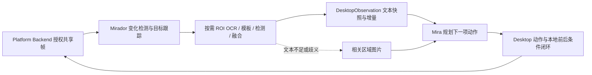

# 会话预算终止与 native-release pet 缺席：分析及修复建议

> 状态：Proposed
> 日期：2026-10-15（Asia/Shanghai）
> 负责人：Mirage 维护者
> 范围：只读调查与方案、依赖反馈登记；未修改运行时代码、用户配置或会话，未重启产品。
> 依据：DEC-085、DEC-087、DEC-088、DEC-084、DEC-089；
> [上下文实施计划](../plans/context-compaction-implementation.md)、
> [M8 计划](../plans/m8-mira-pet.md)。

2026-10-15 文档落地：后续以 [DEC-090](../decisions/DEC-090-continuous-task-execution.md)、
[DEC-091](../decisions/DEC-091-local-semantic-perception-and-action-loop.md)、
[DEC-092](../decisions/DEC-092-native-product-pet-delivery.md) 为决策依据；
[M9](../plans/m9-continuous-tasks-and-local-perception.md) 与 M8-12 跟踪实施。
下文是调查时快照和方案推导，不代表代码已修复。

## 1. 已确认事实

### 1.1 会话证据

读取 `~/.local/state/mirage/session-state.json`：schema 1，9 个 session、26 个
chat turn，12 次成功、14 次失败。失败分类为：

| 分类 | 次数 | 证据边界 |
| --- | ---: | --- |
| `turn budget exhausted before a final answer` | 7 | 模型步骤上限，不等于 context window 耗尽 |
| `model output remained incomplete after recovery budget` | 1 | 旧输出恢复路径耗尽，不能仅凭此确定具体 provider finish reason |
| 其他失败 | 6 | 包含视觉授权/读取、动作验证和请求期限问题；不能统一归为 token 不足 |

最新失败为 2026-10-15 09:56:16 +08:00，session `c61e0580…`，
turn `bc78e872…`，记录 **16 个模型步骤、17 次工具调用**。最后几步依次出现：

1. `type_text` 被拒绝：`verify the previous action; uncertain effects require human review`。
2. 再次 `type_text` 被拒绝：`final_turn_tools_closed`。
3. 过程投影仍出现验证/再次输入的提案；最后一条显示“工具未执行或未完成”。

最后一条是 `ConversationCapture::settle` 对未结算展示 part 的兜底文本，不是新的
平台执行凭证，不能据此声称第 17 次输入已经执行。日志没有完整预算与模型响应诊断，
也不能证明本次发生了 context window 溢出或 provider 输出截断。

### 1.2 当前预算实现

- `integration/mira/src/model_layer.cpp` 固定 `max_turns=16`、
  `max_tool_executions=32`、`max_recoveries=2`、`max_output_continuations=3`。
- 第 15 次 supply 提示收尾，第 16 次标记 final；工具仍向模型暴露，在 handler
  中统一拒绝。若模型在最后一轮继续提工具，拒绝后已经没有下一轮读取回执并生成答案。
- pinned `ConversationLoop::run` 的有界 for 循环同时消耗正常步骤、恢复及续写的
  模型轮次；恢复/续写的独立计数并没有增加循环上限。
- 现有测试覆盖了 final-turn 拒绝和 MaxTurns 失败，因此“测试通过”并不证明长任务
  可继续，也不证明最后一轮一定有可见收尾。
- profile 输出准入上限还使用固定 22 倍包络；修改轮次时必须同步计算，避免路由拒绝。
- 桌面动作验证另有 32 条记录上限。提高模型/工具总数时必须一起审计该容量；
  不得让新预算被另一个隐藏的更小上限截断。

### 1.3 DEC-088 生效条件与覆盖边界

只读 `model.get` 与本地 `service.json` 一致：当前选中 `deepseek-flash`，
未声明 `context_window_tokens`。另两个模型的窗口配置不会自动用于它。
当前代码只有在窗口非零时才接线 history transformer；同样也不启用窗口 preflight
和基于窗口余量的图片降级。因此当前配置下 DEC-088 的这些路径不工作。
历史 turn 没有模型配置快照，不能反推每次旧失败使用相同配置。

已实现的 builder 仅对工具段调用 Layer 0；非工具 assistant 文本逐字透传，
system/goal/此前会话、当轮供给和工具 schema 未纳入同一个输入预算。工具段被整对
丢弃，不等于已建立保留进度、约束和待验证动作的任务摘要。每轮从完整 history
重新计算，当前变换不会改变循环轮数。

还需新增协议回归：Messages 思考回放可能将 thinking、文本和多个 tool call 放在
同一 assistant item；builder 当前只取第一个 call key。压缩应以整组调用及对应
results 为原子单位，否则存在孤立 call/result 的静态风险。本次未执行该复现。

DEC-088 证据目前明确限于 fixture，真实 20/30 轮任务仍未验收；其文档中的
能力接线完成不能解释为长任务问题已关闭。

### 1.4 Pet 运行与构建事实

- 当前 release cache 的 `MIRAGE_ENABLE_PET_PREVIEW=ON`；调查时 pet 可执行文件、
  字体与九套 WebP 均存在，不能描述为当前磁盘载荷全部丢失。
- 当前托盘 PID 118422 自 09:53:22 运行，native PID 118443；没有 `mira_pet` 进程。
- `/proc/118422/exe` 为 `(deleted)`，SHA-256 与磁盘上的托盘不同，证明用户正在
  使用被替换前的旧进程。本次同时观察到其他工作正在重建共享 native-release，
  所以文件时间只是调查时快照，不能用它证明启动当时 pet 是否存在。
- `product.control(status)` 返回正常 frontend 状态、`active_work=0`，完全不含
  `pet_pid/pet_state/pet_diagnostic`。按当前源码契约，这对应没有挂接 pet carrier；
  与“carrier 已启动但动画透明”不同。`pet.status` 能返回任务失败投影只证明投影
  服务可用，不证明 pet 窗口已启动。
- `apps/service/host.cpp` 仅在启动时探测相邻 `mira_pet` 文件并注入 config.pet；
  缺失时静默跳过。运行后补建文件不会重新探测。
- `CMakePresets.json` 的 native-release 未显式启用 pet；预览开关默认 OFF。
  README 的产品构建命令只列 launcher/tray/native。CI 额外手工传 ON，
  因而其 pet 测试不能覆盖“用户按默认 release 命令构建”的缺口。
- M8-08 安装交付仍 Planned，当前 pet CMake 没有正式安装载荷规则。

现阶段结论是：当前运行实例没有可用 pet 进程，启动发现与交付契约存在缺口。
“启动时漏建了 pet”是与证据一致的解释，但具体旧实例为何未挂接 carrier，仍需
使用一致版本的完整产品做干净启动取证；本次未退出、重启或启动用户产品。

## 2. 建议实施顺序

以下均为方案；实施前在所属计划分配稳定工作项。维护者后续明确：长程任务不应
有模型步数限制，应减少工具失败和往返，并将可确定的视觉判断下放给 mirador。
原先“提高到 64 步/128 工具”的建议撤回，不能用更大的硬上限代替持续执行。

### P0：取消按累计步骤/工具次数停止的产品策略

1. 正常任务默认不按累计 model steps/tool calls 停止，也不默认附加替代性的全任务
   总 token/总时长硬终止。计数用于统计、异常识别与进度，显式用户预算另行承载。
2. 保留每次模型/工具/观察的期限、重试和输出续写上限、权限与取消、背压及内存
   容量；上下文不足先 compact。真实不可恢复错误、授权撤回、接管、取消及确切
   无进展异常有独立结果。正常执行很久本身不是异常。
3. 删除第 15/16 轮强制收尾与 final-turn 关闭逻辑；为实际停止原因提供有限文本
   收尾和宿主事实摘要。不把未完成任务标为成功。
4. 将当前按整个 run 累积的动作记录、frame/观察次数等容量审计为活跃窗口/每操作
   预算：归档已结算记录、压缩历史、固定帧缓存；未确认副作用不能淘汰。不能删除
   一个上限又在第 32 个动作或第 N 张图撞上另一个累计计数上限。
5. 重做 profile 固定 22 倍包络和请求准入记账；每次 admission 有真实有限预算，
   累计用量有可观察统计，不能用无限值或整数最大值冒充资金化预算。

本地 ZCode 主循环与异常提醒对照、Mira 公开接口缺口及具体视觉方案见第 5 节。
缺口已登记 [MIRA-20261015-002](../dependency_feedback/mira.md#mira-20261015-002)。
不以反复新建 loop/任务从头执行来绕过 pinned 边界，不修改 third_party。

### P0：恢复 pet 的可重复交付

1. 明确 native 产品是否默认携带 pet；建议 native preset 显式开启现有 pet 构建，
   增加包含 launcher/service/tray/native/pet、字体、素材与 vision bundle 的
   聚合目标，补齐正式安装规则；不要依赖旧 CMakeCache 或残留可执行文件。
2. 产品启用 pet 时，缺文件/资源应有明确状态、原因和修复入口。能力发现必须区分
   状态投影服务、可启动 carrier、实际 running/ready 窗口；避免 pet.status 可用
   造成“桌宠已运行”的误解。
3. 从一致版本的 staging 目录验证后再交付到桌面入口使用的路径；记录源码版本、
   产品文件/素材摘要与运行进程版本。对已有 owner 明确提示需要正常退出再打开，
   不靠覆盖运行中文件声称完成升级。
4. 下一次获准实施时，正常关闭当前空闲产品并从完整 release 启动，先读
   product.pet_state/diagnostic，再验 ready PID、角色像素、动画与气泡。
   若仍失败，按实际诊断处理，不直接归咎素材或 GPU。

### P0/P1：语义观察优先，并补齐 DEC-088 请求级预算与诊断

1. 通过真实服务端模型元数据或明确用户配置取得窗口；不要猜测 deepseek-flash
   这一别名的窗口。窗口未知时显示“上下文管理未启用/窗口未知”，并考虑独立于
   模型真实窗口的、有界本地 history 保留策略，不能静默宣称压缩已启用。
2. 同一预算计算纳入 system/goal、会话、当轮观察/图片、工具 schema、history、
   输出及安全余量。继续复用 Mira Layer 0；按 authority 和协议要求保护当前目标、
   最近完整工具组及待验证动作，以结构化 checkpoint 保留进度。
3. 修正 usage 锚点在压缩后只加正增长、不减缩量的行为；新请求必须能重新校准，
   避免压缩成功后仍沿用旧的大 input 值挤压输出。按请求形态/估算与 provider
   报告共同验证，不能把本地估算当成精确 provider 计数。
4. 持久化脱敏预算诊断：稳定 stop_reason、选中模型和窗口、实际输出限额、步骤/
   工具/恢复/续写计数、输入用量质量、压缩前后规模/降级原因与剩余任务。
   `history_transforms` 只代表变换应用次数，不能替代“实际减少了多少”的指标。

## 3. 验收条件

- 重放最新任务的脚本场景：需要超过 16 步仍可完成，且动作不重复；在最后一轮
  的强制关闭策略移除后继续推进；增加超过 64/128 步的场景，证明没有替代计数上限。
- 覆盖显式用户预算耗尽、每操作预算耗尽、输出连续截断、模型异常/准入拒绝、运行中取消、
  deadline、shutdown；保持终态幂等、迟到结果拒绝与 uncertain side effect 屏障。
- 覆盖未知窗口、已知窗口、多工具+thinking、巨大 OCR、压缩后 usage 锚点回落、
  协议配对及任务约束保留。执行真实 provider 的 20/30 轮任务，不能只缩小 fixture
  窗口证明压缩触发便关闭长期稳定性问题。
- 从全新构建目录按默认 native-release 产品命令构建；搬到 staging 并从任意 cwd
  启动，核验 pet payload、ready、九态、实时气泡、独立启停与整个产品关闭。
  覆盖缺 pet/缺资源/摘要错误与旧 owner 复用时的可见诊断。
- 执行相关单测、ASAN/UBSAN；涉及跨上下文状态或关闭路径时追加 TSAN/故障注入。
  Xvfb 不能替代真实桌面的透明、焦点、DPI/多屏验收。

## 4. 本次验证范围

已执行：JSON 统计与末尾事件检查、源码/公开 API/既有验收记录核对、CMake preset
与 cache 检查、进程和文件 SHA 对比、只读 IPC hello/model.get/product.status/
pet.status；本地 ZCode 源码对照及 freshness 检查。未执行：构建、测试、模型调用、
桌面操作、产品重启、配置变更、依赖修改。
本文件是调查结果和待评审方案，不是修复完成或验收通过记录。

## 5. 维护者澄清后的方案：持续任务与本地视觉闭环

### 5.1 ZCode 的实际做法

对照本地 `~/ZCode` HEAD `29628c9a`：

- `apps/zcode-cli/AGENTS.md` 明确主循环长程任务优先，不用 tool call 次数做硬停止。
- `core/src/runtime/methods/turn-loop.ts:47` 为 `while (true)`，每轮检查取消、处理
  steering、microcompact 与 auto compact；依据 model step 返回值结束。
- `turn-model-step.ts` 在 context exceeded 时允许有界 reactive compact；正常工具
  批次执行完成后继续循环，step/tool 累计值不构成停止条件。
- `turn-tool-warnings.ts` 与 `helpers/model-anomaly.ts` 仅发异常事件和提示；相同
  工具/参数连续 3 次默认触发提醒，tool count 阈值也是提醒，不是硬停止。
- `maxTurns` 仍出现在类型/子任务配置等位置，不能据这些字段认定主循环有限。
  独立 memory extractor 等有限辅助循环不代表主任务策略。
- compact 反复快速填满、输出截断续写耗尽等仍是显式异常，持续运行不是无界重试。

freshness 脚本报告本地 main 落后已知 origin/main 一个提交，本次未更新该仓库。
另用 `git show origin/main:...` 核对已知 `aac47556` 版本，同样以持续主循环和
compact 承载；未将本地 checkout 宣称为最新远端，也未对 ZCode 执行构建/测试。

### 5.2 Mirador 能承载什么，当前没有接上什么

| 能力 | pinned 公开入口/事实 | Mirage 需要的产品装配 |
| --- | --- | --- |
| 无变化/局部变化/全局变化 | `PerceptionSession::analyze_change`、`ChangeReport.changed_regions` | 作为实际调度门控，而不是只计算报告；按 ROI 重新识别 |
| OCR、detector、缓存 | `run_ocr/run_detector`、`CachePolicy`；backend 由宿主注入 | 优先读取相关文本/区域；观察缓存与动作后新证据分开 |
| 融合与相邻帧身份 | `fuse`、`SemanticSnapshot`、stable_id/generation | 输出有来源与置信度的有界文本快照及增量 |
| 跨帧目标跟踪 | `ObjectTracker` 的变化门控、邻域验证、运动补偿、丢失/重检测原语 | 新增私有集成适配，引用须重验；当前未消费，公开头仍标 Experimental |
| 任意图片描述/业务理解 | fusion 的 `description` 留空，视觉不推断可交互角色 | 仍由模型处理；按需提供局部截图，不能把 OCR 称为通用视觉理解 |

Mirador 不负责屏幕采集、权限或硬实时线程。Runtime 用既有平台共享帧与 kairo
worker/通信原语驱动它；低延迟目标要实测，不能凭本地视觉能力宣称实时保证。

具体代码差距：

1. `DesktopImageTurn::native_ocr` 调用 capture；`supply` 仍可能追加 ImagePart。
   现在的“先截图→再 OCR”会重复取帧，OCR 之后也没有默认切为纯文本观察。
2. `VisualObservationPipeline::read_image_ocr` 明确关闭 change/fusion，且设置
   `CachePolicy::kRefresh`；这是为强新鲜度设计的路径，不能直接改成全局缓存。
3. `VisualSessionHost` 先计算 change，后续 OCR/detector 仍按 request 标志执行；
   尚无按 change 结果分支的完整产品策略。启用变化检测不等于已经减少 backend 调用。
4. 当前 native `input_actionable` 依赖 `supply_images_`，因此“去掉图片但保留定位动作”
   需要新的受管语义/视觉引用契约；不能只删除 ImagePart 然后继续用旧坐标。
5. DEC-069 已有本地 OCR/模板定位→一次动作→后条件的闭环，但只向 workflow 注册。
   应抽取并复用其能力到 native 会话，而非再建一套视觉点击或验证系统。

### 5.3 建议的数据流与职责

- 一个授权图像源一个串行 perception owner。订阅/读取平台最新帧，任务活跃或有
  本地等待条件时工作；无必要时休眠。帧用 LatestMailbox 合并，不能积压队列。
  实际已接纳的动作和验证请求必须显式结算，不能被背景 latest-wins 刷新覆盖。
- 无相关变化：保留当前观察并返回 changed=false，不调用模型判断“还要不要等”。
  局部变化：只处理相交目标/文本区域，必要时加上下文边距。切页、布局变动、目标
  丢失：明确重识别或上报，不把 track 预测当成已确认新位置。
- 模型默认得到 `source/session/frame_sequence/generation/epoch`、相关文本与区域、
  来源/置信度、增加/更新/消失条目、目标引用及动作后条件结果。摘要是确定性事实
  投影，不再调用另一个模型写屏幕描述；文本预算与完整基线/增量衔接均有界。
- 像素留在本地供身份、坐标和派发前守卫使用；只有任务需要图片语义、文本缺失、
  重名/歧义、复杂 Canvas/图表时才向模型送目标 ROI，必要时退回全图。
- `stable_id` 不等于平台可点击语义。点击只能经已有 input 权限和当前证据解析；
  不从 OCR 字符串直接推断控件角色，不复用过期 image_scope，不自动续期旧坐标。

### 5.4 减少乒乓的操作契约

将模型参与的“截图→OCR→点击→verify→wait→截图”收敛为：

1. 一次 `observe` 返回文本、引用、变化与所需能力事实，直接取本地最新有效快照。
2. 一次目标动作请求声明目标引用及可判定的后条件；宿主本地完成新鲜度/唯一性
   检查、定位、派发一次输入、等待相应新证据、核验并回传结果和快照增量。
3. 一次 `wait_for` 声明文本/模板/目标状态条件；本地观察直到满足、取消或单次
   等待期限到达，模型不做 wait/capture 轮询。它只观察，不产生额外输入。

接口名为方案示意，不代表已经注册。复用 DEC-059/069 的固定条件、共享观察和
已有 `DesktopActionVerification`，同时修订“每次动作必须另调 verify”的提示：
本次 receipt 已经包含同一动作的有效后条件时直接消费；未验证/不确定时仍走恢复。

可恢复且确认未派发的 stale/布局变化，允许本地在同目标身份下有限次重新定位；
目标重名、身份无法确认就返回歧义及相关 ROI。动作已派发后只追加只读核验，禁止
重发点击/输入。动作后证据必须越过源帧水位，OCR 结算按条件要求强制新识别；
背景缓存命中、跟踪相似度或“屏幕没变”都不能冒充业务成功。

### 5.5 分步交付与验收

- 第一步：确认 Mira 持续循环能力缺口并补最小公开契约；消费后移除主任务累计
  步骤/工具上限及隐藏上限。保留原 pet 构建/运行修复，作为独立产品交付工作。
- 第二步：先做 text-first observe 与动作 receipt 携带后观察，复用现有 OCR/
  模板能力，减少重复截图和显式 verify 往返；同时完成请求级 compact。
- 第三步：变化驱动观察、ROI 更新、本地 wait_for；接入 ObjectTracker 的目标
  维持/重捕获，并对 Experimental 契约隔离与取证。无需为基础文本观察强制引入
  NanoTrack 权重或另一个模型。
- 用同任务/同页面状态作 A/B，记录端到端完成率、每类失败率、模型往返数、图片
  数/像素、provider input tokens、OCR/detector 实际调用数、动作后等待的 P50/P95。
  目标是完成率不下降、往返和图像输入减少，具体幅度由基线实验确定。
- 必须覆盖：静态页面、微小文字变化、动画噪声、滚动、弹窗、相似/重名目标、丢失
  后重捕获、慢模型、权限撤回、取消/shutdown。微小文本变化不能被粗略 dHash
  静默忽略；判定重要文本/后条件时强制对应 ROI 的新证据。
- 历史日志的描述性统计：166 个工具 part，36 个 failed；screen.capture 为
  48 次/21 失败，vision.ocr 为 9 次/4 失败。它们跨版本、任务和权限条件，只用来
  排查优先级，不能当作当前版本识别精度或方案收益基准。
