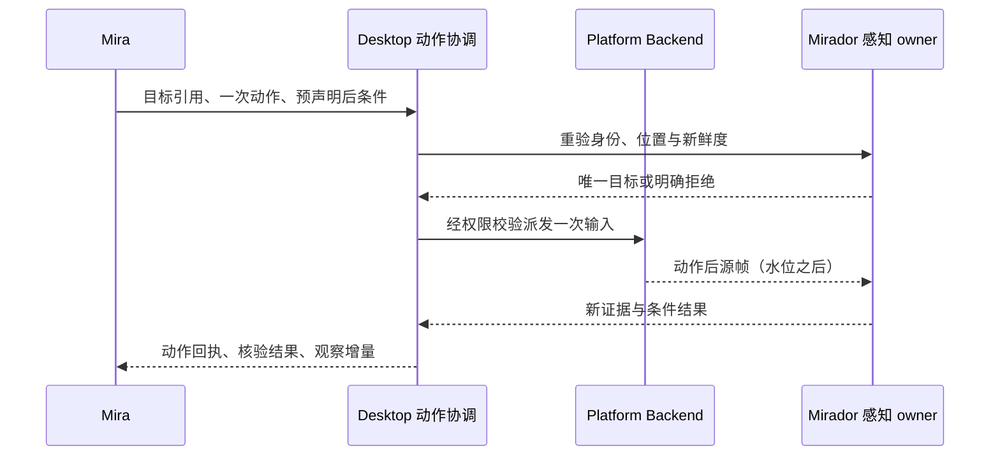

# DEC-091：语义观察优先与 Mirador 本地动作闭环

> 状态：Accepted（2026-10-15 维护者确认本地视觉下放与减少工具往返方向）
> 日期：2026-10-15
> 负责人：Mirage 维护者
> 冻结里程碑：M9-05/07/08/09/10/13
> 替代/被替代：扩展 DEC-016/069；部分修订 DEC-075/081 的供图耦合及逐动作显式 verify 要求

## 背景与问题

当前会话中截图、OCR、输入、verify 和等待经常各占一次模型往返。native OCR
重新取帧，后续供给仍可能附图；计算变化报告也不等于后续识别已跳过。历史日志
中的截图失败与观察失效说明，需要改善调用链和引用连续性，不能只调整提示词。
事实及证据范围见[分析记录](../analysis/session-budget-and-native-pet-regression-20261015.md)。

Pinned Mirador 已提供变化检测、ROI OCR/检测、缓存、融合快照、稳定 ID 及
ObjectTracker 原语；Mirage 已有源帧水位、动作重验和本地视觉 workflow，可复用。
Fusion 不生成任意图像描述，也不推断平台可点击角色。ObjectTracker 公共头仍标
Experimental，不能继承未经当前产品验证的性能或兼容性保证。

## 决策

### 1. 观察默认回传文本事实，图片按需供给

模型默认接收结构化观察，事实投影与增量装配保持确定性：来源、帧/快照版本、相关文本与区域、证据来源、
置信度、可解析临时引用及变化增量。平台无障碍语义、OCR、模板和 detector 事实
分别标明来源；不增加“图片转描述”的第二个模型调用。

允许当前任务的 LLM 在需要理解图像时，为本地视觉对象提交语义标定，后续由
Mirage 保留并通过增量观察复用；标定不是每帧描述。其归属、绑定及失效规则见
第 7 节，不覆盖原始识别证据。

任务需要图表/图片含义、复杂 Canvas、未标注图标，或本地证据不足/有歧义时，
向模型提供相关 ROI；只有局部视野不足时提供全图。模型可请求升级观察，相关
失败须显式回传，不能反复返回无法支持任务的纯文本。像素留在本地用于重验，
不要求每轮随文本上传；原始坐标工具作为受控回退保留。

### 2. 感知按变化和目标需求调度

2026-10-20 补充：连续帧采用轻量级增量视觉状态、事件驱动语义理解与按需 VLM
分层；Mirador 承载通用视觉融合、跨帧身份、空间关系和差分，Mira 提供任务注意
与升级策略，Mirage 承载采集、kairo 调度、产品绑定及动作反馈关联。先交付状态、
身份与事件，再扩展高级语义及另行立项的长期视觉记忆。具体待冻结契约和研究
边界见 [DEC-109 第 0/8 节](DEC-109-continuous-perception-attention-and-pet-coexistence.md)。
MiniCPM-o 4.5 仅用于参考视觉 token 压缩与时分复用机制；不纳入后端选型，
不引入常驻 Video-LLM 或每帧描述路径。

端侧低负载优先：先复用现有帧、视觉 worker、VisualScene 与模型供给，接通变化
结果对昂贵阶段的门控，不新增常驻神经编码器或推理 GPU 要求。时间组织在消费
时装配，不要求周期唤醒模型；资源与质量按 DEC-109 的产品门禁联合验收。

Platform Backend 承载授权采集。Runtime 组织一个图像源一个串行 perception
owner，复用现有 kairo blocking worker；共享帧用 LatestMailbox 合并，快照发布
复用 DoubleBuffer/Topic 等公开原语。无任务/订阅需求时暂停感知，关闭时先停止
生产、取消并排空工作，最后由外部 owner 关闭 Executor。

无相关变化时复用观察；局部变化仅重新识别相交 ROI 及所需上下文；布局突变、
目标丢失和来源改变触发重识别。粗略 dHash 不是重要文字无变化的证明：文本
条件、关键区域和最大证据年龄须有强制新识别路径。背景观察可合并，已接纳的
动作、核验和等待必须各自显式结算，不被 latest-wins 刷新静默覆盖。

采样节奏、ROI 合并、缓存、忽略区域和工作预算在 M9-07 按实测冻结；不承诺硬
实时。Pet/气泡的视觉占位按 M8-06 统一处理，不能用宽泛 ignore 区域遮掉任务目标。

#### 连续帧的性能与内存底线

- 连续帧是输入源，不要求每一帧都复制、编码、识别、融合和发送。优先消费平台
  可用的 damage/dirty-region 信息，再用 Mirador 变化检测确认相关区域；平台
  只提供完整帧时仍允许取完整帧，但不能因此重跑全屏 OCR/YOLO。平台差异留在
  Backend，不把增量采集支持当作跨平台既有保证。
- 采集回调只做有界校验、帧句柄/元数据投递并及时归还平台 buffer。安全支持
  所有权转移时共享不可变像素；必须复制时明确单次字节上限和释放点，不为
  每个消费者保留一份整屏副本。不为文本观察预先 PNG 编码、缩放和生成 artifact。
- 帧存量按图像源限制：最新待处理帧、正在处理帧及必要的基线签名/目标 ROI。
  每个槽位同时有数量和字节预算；额外的后条件帧、标定 ROI、GPU 纹理、缩略图、
  不可变快照旧代、track 模板及语义绑定均纳入总预算，不能因引用长期存活失控。
- 采集、轻量变化检查、重识别和模型发布分别限频/计量。静止退避，有相关变化
  或动作/等待需求时提高处理优先级；重负载下合并 ROI、覆盖背景待处理帧和降低
  分辨率/频率，明确报告降级。动作后的新证据不得被背景工作饿死或丢弃。
- 跳帧/合并后的差异必须相对最后一次已提交的观察基线计算，或合并该基线以来
  的完整 damage 集，不能只比较最后两张采集帧而漏掉未处理变化。基线不一致、
  分辨率/变换改变或无法保证增量覆盖时，执行有界重建并报告 reset。
- 局部感知只更新受影响对象与关系，不重新复制/序列化所有未变化条目。共享
  不可变对象数据，并限制快照保留代数和引用字节；过载导致区域未处理时显式
  标记 pending/incomplete，不能把未知区域当作已确认未变化。

M9-07 在代码实施前冻结资源表：各类容量/字节上限、ROI 合并/全量升级阈值、
CPU/GPU 工作预算、退避/限频和过载策略。M9-12 用实际分辨率/帧率/源数量验证
峰值 RSS、GPU 存量、内存带宽/拷贝量、CPU 与尾延迟，不以 token 节省代替本地
资源验收，也不凭空填写跨设备性能数字。

### 3. 临时引用与增量保留完整证据链

观察关联 source/session、frame_sequence、snapshot generation、environment/
authority epoch、坐标变换、证据年龄和 backend revision。增量携带 base revision、
当前 revision 与 added/updated/removed；首次、基线不匹配、重连或 compact 后
基线丢失时回传有界完整快照，不默默应用断裂增量。截断和省略必须可见。

本地保留“当前完整对象状态”，对外按增量发布；未更新对象的视觉事实和已绑定
语义保持，不因收到新 frame_sequence 或其他区域变化而整体清空。区域删除以
removed/tombstone 明确通知，标定变化另有版本；客户端基线恢复同时恢复仍有效
的语义。对象身份、位置、识别内容与语义标定分别版本化，避免位置更新触发全部
语义重算，也避免同一 stable_id 掩盖内容替换。

“本次重验身份的帧”与“实际执行 OCR/语义标定的帧”分开记录；复用旧语义不刷新
其识别/标定时间或伪造当前帧识别证据。动作派发权限和新鲜度仍按当前证据判断。

面向模型的目标引用由 Mirage 注册和解析，不能以 Mirador stable_id 直接充当
执行凭证。语义文本本身是不可信观察数据，不获得系统指令权限。引用可在派发
时取得新证据重新解析同一目标，但必须检查来源、目标身份、唯一性、权限与
epoch；失效时返回新观察或歧义，不自动延长旧 image_scope/旧坐标有效期。

### 4. 动作与后条件在本地完成一次闭环

复用 DEC-059/069、DesktopActionVerification 和现有 ActionCoordinator，不新建
另一套动作系统。模型一次调用声明目标及固定后条件；宿主本地完成重验、一次
派发、有限等待和核验，回传同一 action_id、condition digest、派发/释放/不确定
状态及证据。回执已完成有效核验时，无须为相同条件再调用 verify；未核验或
不确定的动作仍走原恢复路径。

只在确认未派发且身份可重新确定时，允许有限本地重新定位。派发后不自动重发
点击/输入，只能追加只读核验。缓存命中、track 预测、相似度和“未变化”均不能
代替动作后的新证据；frame 水位、OCR 强制新识别、权限及 epoch 守卫继续生效。
“观察到新帧”也不等于业务完成。

### 5. 等待条件由本地观察驱动

新增受管的只读等待能力：声明文本、模板或已定义目标状态条件，在本地观察流中
等待满足、超时、取消、权限撤回或 shutdown。一次等待有明确期限、活动容量与
背压，不能通过模型轮询截图等待。等待不产生隐式输入；超时不等于主任务失败，
由 Mira 按结构化结果决定下一步。

### 6. 跟踪是定位证据，业务决策仍由 Mira 承担

ObjectTracker 在私有 integration Adapter 中接入，消费变化门控、邻域重验、
运动补偿和丢失/重捕获原语。低置信度、相似目标交换和布局换代必须显式降级；
不能凭位置预测继续点击。Detector/Tracker 后端按实际能力探测，不强制引入
NanoTrack 权重；跟踪尚不可用时保留新识别路径。

### 7. LLM 对象语义标定由 Mirage 持有并随对象增量维护

LLM 可基于已提供的图像/ROI 和候选引用，为 OCR 文本对象、detector 对象（如
已配置 YOLO）、几何闭合对象或 track 标定任务含义，例如“保存按钮”“搜索框”
“目标视频卡片”。标定可来自正常任务模型轮次的结构化输出；仅对缺失/歧义对象
按需请求新图像，不为已确认未变化部分逐帧或重复调用模型。

绑定由 Mirage 的语义标定表持有，关联底层 Mirador 对象。最小逻辑记录包含
source/session、场景/页面身份、对象 ID 及 incarnation、对象/证据版本、标定时
frame/generation、模型请求来源、语义字段、适用范围和依赖的文字/外观/关系证据。
字段名与 schema 在 M9-05/13 冻结；裸坐标、重复使用的编号或 track_id 单独不足以
定位对象。标定响应晚到时，校验原始基线；仅在身份连续性证据支持时映射至当前
对象，否则拒绝或挂起，不能把旧图语义绑定到原位置的新对象。

Mirage 校验引用和绑定关系后，语义可进入 active 状态供规划使用；这表示关联
被接受，不表示模型推断已成为平台事实。原始 OCR 字符串、detector 类别、闭合
几何、track 状态与 `llm_annotation` 来源分开保留；平台 role/interactive/enabled
只能来自真实平台能力。不得将 LLM 标签塞进 ExternalRegion 冒充无障碍事实，
也不把标定当作独立视觉证据反向确认同一模型推断。

| 后续观察 | 语义保留/更新规则 |
| --- | --- |
| 无关区域变化，目标及其依赖未变 | 保留有效绑定，只发布其他增量；不重新请求 LLM |
| 目标移动，身份经新视觉证据确认、含义依赖未变 | 更新 bounds/证据版本，保留语义；重新签发/解析执行引用 |
| OCR 值、外观或语义依赖关系变化 | 只挂起受影响语义字段，其余独立字段可保留；需要时重新标定 |
| track uncertain/lost、遮挡或 ROI 未处理 | 保留有界历史标定但暂停有效使用，不因预测位置延续可执行性 |
| 页面切换、对象替换、ID 复用、拆分/合并或身份冲突 | 撤销对应有效绑定或重新绑定；不按距离/同编号直接继承 |
| 重捕获且同一身份被证据确认 | 核对原适用范围与依赖后恢复；关联不足则视为新对象重新标定 |

整体 environment/snapshot epoch 换代本身不要求删除全部语义，但旧执行引用立即
遵循失效规则；只有在当前来源、场景和对象身份重新关联通过后才恢复可用绑定。
目标身份延续与动作许可/副作用核验分别判断，标定不能放宽权限、新鲜度或业务
后条件，也不能绕过人类接管。

语义标定表不是第二个视觉跟踪器：只保存产品语义及对 Mirador 证据的绑定，像素
匹配/跟踪复用其公开算法。需要供跟踪关联使用的语义描述，经私有 Adapter 严格
映射到公开契约且保留来源；当前 TrackSemantics/VisualRegion 的简化字段不替代
Mirage 标定表，不覆盖原始类别。没有适合的公开扩展时保留在 Mirage，确需上游
能力再登记反馈，不修改 pinned 代码或污染平台事实。

绑定数、文本字节、历史版本、挂起时长和保留 ROI 均有预算；活动任务依赖的
绑定在预算内显式保留，淘汰须通知消费者并要求重新观察，不能遗留有效悬空引用。
默认只在源会话/当前场景范围复用，不擅自建立跨应用/重启的永久语义记忆。

## 分层、兼容性与冻结

2026-10-19：[DEC-109](DEC-109-continuous-perception-attention-and-pet-coexistence.md)
提出 pet 可见共存、识别前任务注意策略、选择性通知及目标局部动作门控，关联
Mirador #41 和 M9-17/18/19。该细化仍为 Proposed，不能以其放宽现行权限、epoch、
新鲜度或动作后证据要求；通用视觉缓存与 Mirage 语义绑定的归属继续按本决策。

第 7 节的语义标定与资源增量契约同属本决策；它们是待实施设计，不代表 pinned
Mirador 已提供通用 LLM 标定持久化接口。

依赖方向保持 `apps/ui -> runtime -> desktop -> platform`；Mirador 类型仅在
integration 私有边界出现，Mira 行为只消费平台无关契约。权限/采集属于 Platform
Backend，目标选择策略属于 Mirage/Mira，像素算法复用 Mirador。

`observe`、目标动作和 `wait_for` 是能力描述，本文不提前发明已注册工具名。
M9-05/13 冻结公开字段、能力协商、基线及标定协议，M9-09/10 冻结输入/输出 schema、错误
与期限。IPC 采用可探测加法扩展，同步 golden、历史投影、示例及旧客户端回退。
禁止仅删 ImagePart 而仍要求旧 input_actionable 条件。

## 备选方案

| 方案 | 结论 |
| --- | --- |
| 每次动作继续上传全图并让模型 OCR/等待 | 模型往返与重复感知开销高，保留为回退 |
| 全面禁用图片，只返回 OCR | 无法覆盖非文字任务，不采用 |
| 另起 VLM 输出屏幕描述 | 增加模型成本、延迟及新的错误来源，不作为默认方案 |
| 取消新鲜度/验证守卫以减少失败 | 无法区分陈旧目标和真实结果，不采用 |
| Mirador 本地事实与闭环，模型按需看图 | 采用 |

## 影响与风险

文本投影可能丢失视觉关系，ROI 切分可能漏上下文，粗粒度门控可能漏微小文字变化，
跟踪可能漂移；均需可见降级、图像回退和负向测试。背景感知也有本地 CPU/内存
成本，不能只减少 token 就宣称性能提升。复用阶段性能力不等于已完成原生 Wayland/
Windows 取证，也不关闭 M7/M8 的平台、目标避让和资源许可门禁。

保留语义会引入错误关联、晚到标定和内存滞留风险；必须按对象/字段的依赖失效，
不能一律每帧清空或无限保留。高频源与慢识别消费的过载、跨代快照被长期引用、
目标不变但文字/上下文改变，均列入验收。跳帧可能错过瞬态画面，本地等待只能
报告采样证据，不能声称未见到就证明事件从未发生。

## 验证方式

M9 以同任务/页面/模型做配对 A/B：完成率、失败类别、模型往返、图片数/像素、
provider input tokens、OCR/detector 实际调用数、P50/P95 时延及本地资源。先
冻结基线与阈值，再运行对照；不预填节省比例。覆盖引用失效、增量断裂、微小
变化、动画、滚动、弹窗、重名/相似目标、派发后超时、取消和 shutdown。

增加高分辨率/多源持续输入与慢消费者 soak；要求帧/快照/标定存量在预先冻结
上限内稳定，输出峰值/平台期和拷贝/识别计数。标定验收覆盖四类候选、无关区域
变化的零重标定、身份保持的移动、内容替换、track 丢失/重捕获、晚到结果、
拆分/合并、预算淘汰及来源隔离。静态部分既不重复识别，也不丢失已确认关联。

## 关联文档和工作项

- 首增量：[状态层契约](../design/visual-scene-incremental-state.md)、
  [资源清单](../design/m9-resource-and-progress-policy.md)、
  [验证记录](../compatibility/m9-incremental-scene-and-pet-build-20261015.md)。
  当前只有 Core 状态/绑定与 Mirador 映射；native/LLM 接线和连续帧链路尚未实施。
- [M9 计划](../plans/m9-continuous-tasks-and-local-perception.md)：M9-05～13。
- [DEC-090](DEC-090-continuous-task-execution.md)、[DEC-016](DEC-016-mirador-visual-integration-contract.md)、
  [DEC-059](DEC-059-visual-text-postconditions.md)、[DEC-069](DEC-069-local-visual-workflow-grounding.md)、
  [DEC-081](DEC-081-native-cua-capability-and-observation-continuity.md)、
  [DEC-083](DEC-083-target-region-stability-reverification.md)。
