# Mirage：Linux / Windows 桌面端设计方案

> 2026-10-03 更新：UI 产品方向按 [DEC-033](../decisions/DEC-033-native-agent-frontend.md)
> 迁移到 EUI-NEO 原生前端，首步会话页面见 [原生设计](native-agent-frontend.md)。
> 本文既有 CEF UI 实现记录作为迁移前基线保留；Runtime/Provider/IPC/Executor
> 分层约束继续生效。整体入口与托盘生命周期尚待 M6-04 验收。

## 1. 项目概述

2026-10-20 决策增量（已接受，待实现）：
[DEC-111](../decisions/DEC-111-target-text-value-verification.md) 采用平台中立的目标
文本值验证：通过 AccessibilityProvider 按需读取同一控件的实际值，受控复制作为
默认关闭的可选增强，局部图像／OCR 作为视觉回退。实际值、视觉存在和新帧观察的
证明范围分开，不事后弱化固定条件，不从 OCR 未匹配推导输入派发失败。
目标身份、完整替换／插入语义、IME 已提交状态、权限、取消和恢复规则见决策；
`action.verify` 保持只读。Platform Backend 封装 AT-SPI／UIA／Portal，公开接口不
暴露平台类型。当前 Provider 尚缺读值及完整复制事务，
[M7-32～34](../plans/m7-target-text-verification.md) 均为 Planned；不声明新增能力已交付。

2026-10-15 决策增量（设计方向已接受，实现待交付）：
[DEC-090](../decisions/DEC-090-continuous-task-execution.md) 定义主任务不按累计
步骤/工具次数终止、单次推进及资源存量有界；
[DEC-091](../decisions/DEC-091-local-semantic-perception-and-action-loop.md) 定义
文本事实/目标引用优先、按变化感知和本地动作/等待闭环，图片按需回退；
[DEC-092](../decisions/DEC-092-native-product-pet-delivery.md) 定义完整 native
产品默认携带 pet 及启动诊断。分别由 [M9](../plans/m9-continuous-tasks-and-local-perception.md)
和 [M8-12](../plans/m8-mira-pet.md) 跟踪，不改变平台/集成分层、权限、源帧水位
与动作后证据要求；不把新设计写作当前已交付能力。

DEC-091 同日补充：连续帧按最后已提交基线增量处理，限制像素拷贝、帧/ROI、
快照旧代及 GPU/track/语义存量。Mirage 可接收 LLM 对 OCR/detector/闭合/track
对象的语义标定，保留未受变化影响的绑定；目标身份和语义依赖变化分别处理，
不将模型标注升级为平台事实或动作后证据。由 M9-05/07/08/13 冻结和实施。

2026-10-19：[DEC-109](../decisions/DEC-109-continuous-perception-attention-and-pet-coexistence.md)
（Proposed）补充可见 pet 与持续采集共存、任务驱动注意策略、状态/通知基线分离及
目标局部输入重验，新增 M9-17/18/19；与 Mirador #41 协同。未实施或验证的平台能力
不作保证，现行采集呈现默认值及动作证据约束继续生效。

机器感知画质按任务可用性取最低档：低清整屏巡检/概览、任务相关局部跟踪、按需
清晰证据 ROI；模型理解与 OCR/YOLO/Tracker、动作正确性和 CPU/内存联合验收，
具体档位按 DEC-109 和 M9-06/07/08/12 冻结，不降低 pet 素材呈现质量。

2026-10-20 连续帧方向补充：采用**轻量级增量视觉状态 + 事件驱动语义理解 +
按需 VLM 推理**。Mirador 负责变化检测、OCR/YOLO/tracker 融合、跨帧身份、
几何空间关系和差分；Mira 根据任务提供焦点、重要性与观察策略；Mirage 负责
受权采集、kairo 调度、产品语义绑定、操作执行与视觉反馈关联。当前状态快照
配合有界事件日志，事件携带来源、代际、时间窗及生命周期；低成本持续维护状态，
关键变化/歧义/任务需要时才供 ROI 或有界关键时间窗口给 VLM。现有 pin 提供
视觉原语，完整连续事件契约仍由 MIRADOR-20261019-001 跟踪。

研究依据及适用边界见[研究映射](../research/2026-10-20-event-driven-incremental-visual-perception.md)，
具体契约与验收见 DEC-109。MiniCPM-o 4.5 仅参考视觉 token 压缩与时分复用：
在推理前控制视觉表示预算，按共同时间轴分组观察、变化与动作反馈并有界交错推进。
模型内重采样与生成期间输入注入依赖模型公开能力，不据此宣称已实现。
不引入 MiniCPM 模型或将其列为后端候选。先完成增量状态、稳定身份和事件检测，
再扩展任务注意与 VLM 解释；长期视觉记忆另行立项。该增量仅为文档，未声明
低端设备资源收益已验证。

端侧低负载约束优先：不增加常驻神经编码、本地 VLM 或推理 GPU 要求，复用
已有视觉 worker、对象增量及任务模型供给。无观察消费者停止生产，静态退避，
变化时只投入所缺证据阶段；时间分组按消费装配，不增加周期模型循环。首要
实施项是将变化结果接到昂贵识别的实际门控，并减少重复采集/拷贝/编码。验收
覆盖 Runtime/native/pet 总 CPU、唤醒、RSS、拷贝与用户应用响应，见资源门禁。

Mirage 是基于 Mira 构建的 Linux / Windows 桌面端产品，为 Mira 提供完整的 PC 运行环境、桌面交互能力与产品界面，使通用 Agent 能够进入用户真实的桌面工作环境执行任务。

Mirage 直接使用 Mira 提供的 Agent Harness Core，包括 Agent 运行、上下文、记忆、Tool/MCP、Workflow、Subagent、行为组织与相关 Agent 基础能力，并负责将这些能力与 Linux / Windows 本地环境连接起来。在视觉层面，Mirage 使用 Mirador 提供的轻量视觉基础设施，对桌面截图和局部图像执行 OCR、目标检测、几何结构分析、视觉 Cache 等处理。

因此 Mirage 的主要工作集中在三个方向：首先，为 Mira 提供统一的 Linux / Windows Desktop Environment，使 Agent 能够访问应用、窗口、Accessibility、屏幕、键鼠、文件、进程和系统能力；其次，将 Mira 与 Mirador 的能力整合为可以长期运行的桌面 Agent Runtime；最后提供面向用户的桌面产品，使用户能够创建任务、观察执行过程、使用 Workflow、管理 Agent，并在必要时介入 Agent 的执行。

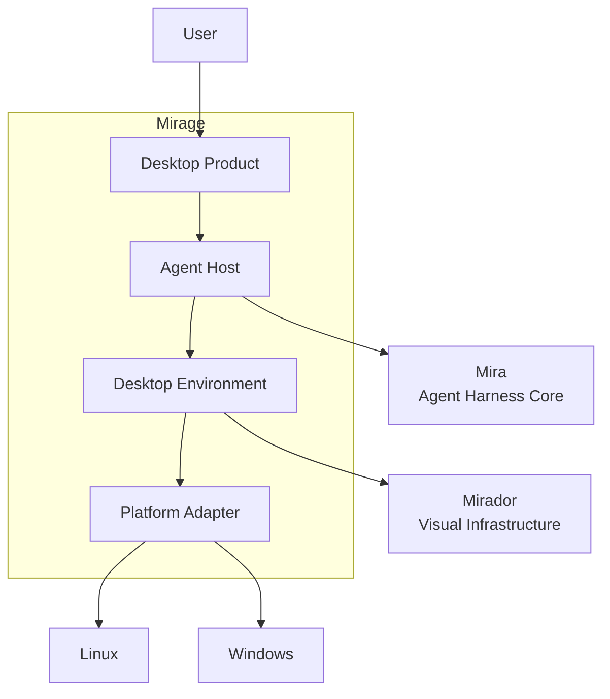

## 2. 需求背景

Mira 提供了构建和运行通用 Agent 所需要的核心能力，但通用 Agent 要真正进入 PC 环境，还需要一个能够连接 Agent Harness 与桌面操作系统的完整产品运行环境。

Linux 与 Windows 桌面中的任务具有高度混合的特征。一个任务可能首先读取文件，然后执行 Shell 命令，再启动某个桌面应用，通过 Accessibility 获取应用状态，必要时分析屏幕图像并执行键鼠操作。对于软件开发场景，Agent 可能主要工作在文件系统、终端和开发工具中；对于普通桌面任务，则可能更多依赖窗口、应用和 GUI；复杂任务通常同时使用这些能力。

因此 Mirage 首先需要解决的是 **PC 环境能力如何统一提供给 Mira**。窗口、应用、文件、进程、Accessibility、截图和输入在 Linux 与 Windows 上分别具有不同实现，如果这些平台细节直接进入 Agent 行为层，就会导致 Agent 和 Workflow 与具体操作系统强耦合。Mirage 需要在平台 API 与 Mira 之间建立稳定的 Desktop Environment 抽象。

第二个需求来自 **桌面视觉感知**。Accessibility 可以提供大量结构化 GUI 信息，但桌面环境中仍然存在自绘 UI、Canvas、游戏、远程桌面、图片内容以及 Accessibility 信息不完整的应用。Mirage 因此需要同时获取结构化桌面语义和视觉信息，并通过 Mirador 低成本地提取 OCR、目标、几何区域和缓存视觉特征，在必要时再向上层提供视觉语义。

第三个需求是 **Agent 的桌面产品化运行**。用户需要能够启动和管理 Mira Agent、提交任务、查看正在执行的行为、观察 Workflow 和 Subagent 的执行状态，并能够处理 Agent 发出的权限申请、确认请求和异常。长时间任务还要求 Agent Runtime 能够独立于主界面持续存在。

第四个需求是 **Linux 与 Windows 的统一产品体验**。两个平台的底层桌面系统差异明显，但对于用户和 Agent 来说，打开应用、读取窗口、操作控件、获取截图、输入文字等行为具有相同语义。因此 Mirage 需要将平台差异限制在 Backend 层，使绝大多数 Runtime、UI 和 Agent 行为能够跨平台共享。

Mirage 的整体需求因此可以归纳为：

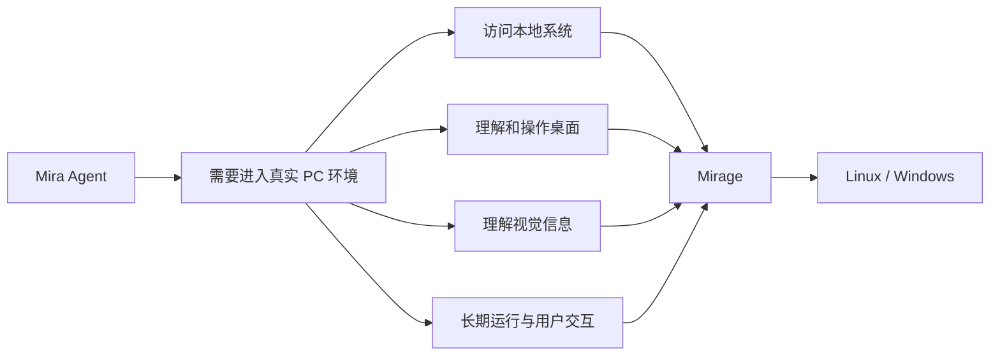

## 3. 设计目标

Mirage 的目标是在 Mira 与 Linux / Windows 之间建立完整的桌面 Agent 产品层。

从 Mira 的角度看，Mirage 应提供稳定的环境接口，使 Agent 可以获得当前桌面 Observation，并执行具有明确语义的 Desktop Action。Agent 不需要关注当前系统具体使用 UI Automation、AT-SPI2、X11、Wayland 或其他平台 API。

从视觉角度看，Mirage 应将屏幕和窗口图像转换为适合 Mirador 处理的输入，并将 Mirador 返回的 OCR、目标、几何区域和 Visual Cache Match 等结果组织进 Desktop Observation，使结构化桌面语义与视觉语义能够共同提供给 Agent。

从产品角度看，Mirage 应提供完整的 Agent Workspace，使用户可以运行 Mira Agent、提交任务、查看任务状态、观察 Agent 行为、使用和编辑 Workflow、查看 Subagent 调用关系，并处理 Agent 请求的人工确认。

整体执行链路为：

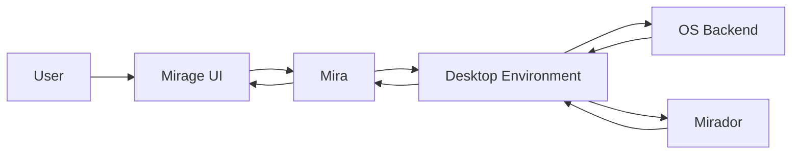

## 4. 总体架构

Mirage 本身主要由 Desktop Product、Runtime Integration、Desktop Environment 和 Platform Backend 四部分构成。

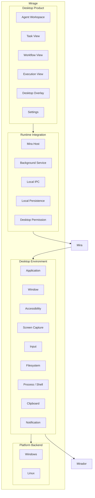

Mira Host 负责在 Mirage Runtime 中承载 Mira 实例以及建立 Mira 与 Desktop Environment 之间的连接。Agent 本身的 Harness 逻辑继续由 Mira 提供，Mirage 只负责宿主生命周期、桌面环境绑定、后台运行和产品层交互。

## 5. Desktop Environment

Desktop Environment 是 Mirage 最主要的基础设施模块。

它向 Mira 提供统一的 PC 环境能力：

```text
DesktopEnvironment
├── ApplicationProvider
├── WindowProvider
├── AccessibilityProvider
├── ScreenProvider
├── InputProvider
├── ClipboardProvider
├── FilesystemProvider
├── ProcessProvider
└── NotificationProvider
```

`ApplicationProvider` 负责应用发现、启动、关闭以及运行状态；`WindowProvider` 负责窗口枚举、前台窗口、焦点、位置和尺寸；`AccessibilityProvider` 提供当前应用的结构化 UI 信息；`ScreenProvider` 提供显示器、窗口和 ROI 图像；`InputProvider` 提供键盘、鼠标以及文本输入；`FilesystemProvider` 和 `ProcessProvider` 提供桌面 Agent 对本机工作环境的直接访问。

这些 Provider 形成统一的环境接口，上层行为不直接包含平台实现信息。

基础 Agent 四工具的后续扩展见 [M10 开发计划](../plans/m10-basic-agent-tools.md)、
[调研](../research/2026-10-16-basic-agent-tools-survey.md)及
[DEC-095 提案](../decisions/DEC-095-basic-agent-tools.md)（2026-10-16，Proposed）。
其分页、文件修改、cwd 与会话接线尚未实现；本节现有 Provider 契约继续有效。

Provider 以访问器形式挂载在 `DesktopEnvironment` 上（`filesystem()` / `process()` 等，
返回空指针表示该环境不具备对应能力，消费方必须 fail closed）。M1 包含
FilesystemProvider（只读文本读取）与 ProcessProvider（有界 shell 执行）；
`M2-01` 冻结了其余七个核心 Provider 的契约（Application / Window / Accessibility /
Screen / Input / Clipboard / Notification），全部沿用 M1 的预算 / 取消 / 错误词表
纪律（[DEC-009](../decisions/DEC-009-provider-scope-budget-cancellation.md)）与
[DEC-005](../decisions/DEC-005-desktop-observation-contract.md)。
`M1-05`（[DEC-009](../decisions/DEC-009-provider-scope-budget-cancellation.md)）
为两者落地范围约束、执行预算与协作取消路径：Filesystem 读取强制 `PathScope`
读范围（空范围 fail closed）与字节预算（超限 fail closed，不静默截断）；
Process 执行在副作用前校验命令长度预算，并经 pinned-free 的 `CancelToken`
协作取消（运行时层将自己的停止令牌适配到它上面，整组进程收尾后返回
`cancelled` 结果）。Permission 判定（`RULE-05`）与用户确认挂点由 `M1-06`
落地为 runtime 层的 Permission Gate（`runtime/permission`，[DEC-010](../decisions/DEC-010-m1-permission-framework.md)）：
动作在进入 Provider 前按 Capability 策略判定（allow / confirm / deny），
Provider 自身保持 permission-agnostic，其硬边界不受判定结果影响。
[DEC-008](../decisions/DEC-008-m1-environment-binding-and-reference-providers.md)
记录了该过渡边界的演进。M1 参考后端是 `platform/linux::LinuxDesktopEnvironment`（实现
desktop 抽象接口；Adapter 依赖 Core 接口），完整 Linux / Windows Backend 分别在
M2 / M4 落地。

例如一个语义行为：

```text
activate(element_ref)
```

在 Windows 上可以最终转换为 UI Automation Pattern，在 Linux 上可以转换为 AT-SPI Action；如果目标来自视觉定位，则可以转换为对应位置的 Pointer Action。

这样 Mira 的 Workflow 和 Agent 行为可以尽可能保持平台无关。

### 5.1 连续输入与设备兼容性提案

[DEC-110](../decisions/DEC-110-continuous-input-and-device-compatibility.md)（2026-10-19，
Proposed）拟扩展 InputProvider：提供从当前位置出发的平滑移动、定时按压、独立
修饰键及由 Task 所有的跨观察持键会话。Runtime 保持单写者，持键期间可取图并
继续决策；取消、接管、失联、撤权与关闭必须释放并报告结果。正常受控持有与
释放失败分开表达；契约与预算冻结稿（能力位、会话键词表、数值预算、状态机、
版本化回执）已于 2026-10-19 随 M7-25 交付至 `desktop/environment` 契约层与
golden 矩阵，待维护者评审，详见 DEC-110"M7-25 契约冻结稿"一节。

2026-10-20 维护者明确目标默认：所有键鼠动作由 Mirage 本地动作层自动规划自然
时序，模型只表达意图，无需传入时长或逐点指挥；常规工具以不暴露通用时间入口
为目标。移动、点击/多击、拖动、滚动、按键/组合键及逐键文本输入均纳入覆盖。
普通点击在同一动作 lease 内完成连续移动、到达重验、按下及释放，再返回动作
结果或进入 DEC-056/109 后置观察与验证；前置/途中安全守卫持续有效。显式受控
持键允许步骤完成后返回 `holding` 并观察，最终验证仍等待释放确认。当前
`glide_ms` opt-in 尚不满足新默认；自动时序、总预算、工具兼容及完成顺序由
M7-25 修订冻结，M7-26/31 接线验收，未交付为现行默认。

验证粒度按 DEC-056 2026-10-20 已接受修订：普通完整输入默认不要求业务条件，
执行完毕即可回报执行事实；动作组末、状态依赖处和任务结束时按需观察/验收。
执行、观察、业务条件分别表达，未请求条件不形成全局 unverified 围栏；显式条件
只约束依赖步骤，恢复不降低原条件。权限/目标守卫及执行/释放不确定性围栏保留。
精确文本取证按 DEC-111 按需选择；分层门控 v2 首增量已接入会话工具（修改工具
3.0.0、verify 2.0.0、可选 depends_on），结算复用有效观察且不采集。默认自然时序、
新动作组与平台实测仍由 M7-25/26/31 继续推进，精确值能力由 M7-32～34 交付。

2026-10-20 后续：三条物理点击工具 4.0.0 已按 DEC-110 点击子集迁移为默认本地
自动接近，无模型移动时长参数；距离/目标宽度计算时长，到达守卫后才点击释放。
Portal 起点从当前授权流 Cursor metadata 回读；不可得时拒绝，不瞬移建立起点。
DesktopCaptureSession::pointer_position 只读已采集帧的起点/尺寸/来源序号；共享点击
在输入租约前检查一致性，无副作用的起点拒绝不推进 epoch。PipeWire 按 Format
完成元数据协商，Cursor 容量覆盖 Mutter 46 固定 384×384，保持 512×512 有界上限。
策略与 native-release 验证见[自动接近点击验收](../compatibility/automatic-pointer-approach-20261020.md)。
其他键鼠自然时序与动作组仍未交付。

设备层输入为提高应用兼容性的独立需求：针对过滤软件注入或依赖设备输入的应用，
并行评估 Linux uinput / Windows VHF 与外接 USB HID。平台设备/驱动/协议留在
Backend，共享动作语义与所有权；按具体应用、版本和环境验证接收与业务效果。
活动会话不热切换设备，未知副作用不自动换后端重发。输入法状态与候选选择独立
建模，设备输入不代替焦点、布局和文本回显验证。

后续实施与验收见 [M7-25～31](../plans/m7-continuous-input-and-device-compatibility.md)。
本节为提案索引，DEC-054/100 的现有完整动作及当前授权/释放契约继续生效。

## 6. Desktop Observation

Mirage 向 Mira 提供的桌面状态应表示为结构化 `DesktopObservation`。

一个 Observation 可以包含：

```text
DesktopObservation
├── ActiveApplication
├── ActiveWindow
├── WindowGeometry
├── SemanticSnapshot
├── VisualSnapshot
├── FocusState
├── PointerState
└── EnvironmentState
```

其中 Semantic Snapshot 来自 Accessibility，Visual Snapshot 则由 Mirage 与 Mirador 协同产生。

DesktopObservation 的 schema 1.0 字段集已在 `M2-01` 冻结
（[DEC-005](../decisions/DEC-005-desktop-observation-contract.md)）：结构化
SemanticSnapshot、焦点元素引用与指针状态入字段集；加字段升 minor 版本，破坏性
变更升 major 版本。

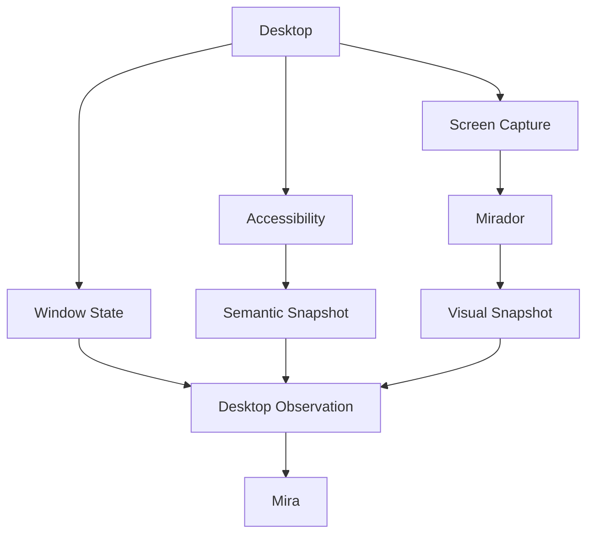

Mirage 可以根据当前任务按需生成 Observation。例如当前任务仅涉及终端和文件操作时，无需持续执行屏幕视觉分析；只有在 Agent 需要理解 GUI 时才获取对应窗口状态，在 Accessibility 信息不足时进一步启动视觉分析。

这种按需感知机制可以减少截图、OCR、目标检测和 VLM 带来的计算开销。

M2 落地形态（`M2-06`）：desktop 层 `ObservationAssembler` 按组件请求组装一条
`DesktopObservation`（active_window / semantic_snapshot / pointer_state /
environment_state；visual_snapshot_ref 保留至 M3）。请求的组件是强制的：环境缺
对应 Provider（访问器缺位）以 stable 错误码 fail closed，失败组件记录自身错误且
不阻断其余组件；`ok` 仅当全部请求组件捕获成功，从不静默不完整。绑定层
（`integration/mira`）将 pinned `ObservationRequest.required/optional` 映射到该
组装器：required 组件无法交付时整个 observe 失败（fail closed），optional 组件
尽力而为并以 observation quality 的显式降级记录呈现；Semantic Snapshot 经投影
进入 pinned `UiTreeSnapshot`（`@eN` 引用保留于 stable hint，映射后经 pinned
validator 复验），见第 11.1 节。

## 7. Accessibility 与 Semantic Snapshot

Accessibility 是 Mirage 理解标准桌面 GUI 的主要结构化数据来源。

Windows Backend 使用 UI Automation，Linux Backend 使用 AT-SPI2，将平台 Accessibility Tree 转换成统一节点结构。

Mirage 不直接将完整 Accessibility Tree 作为 Agent Observation，而是生成更紧凑的 Semantic Snapshot：

```text
Application: Visual Studio Code
Window: mira — Visual Studio Code

@e1 menu "File"
@e2 tree "Explorer"
@e3 treeitem "src"
@e4 editor "main.cpp" [focused]
@e5 button "Run"
```

每个当前可交互对象获得临时 Element Reference，例如 `@e5`。Mira 可以基于这些引用执行行为：

```text
activate(@e5)
input_text(@e4, "...")
```

Mirage 负责在行为真正执行时将 Element Reference 解析为对应平台对象。

Mirage 侧以结构化 `SemanticSnapshot` 承载该模型：节点含 `@eN` 引用、稳定角色词表、
父索引与几何，节点预算超限 fail closed（`RULE-07`）；设计文档所示的紧凑行式文本
即快照的确定性渲染结果。动作寻址采用多提示 `ElementTarget`（reference / semantic /
structural / visual / spatial / raw 自由组合），解析顺序固定为：快照 reference →
Accessibility（semantic → structural）→ Mirador 缓存 / OCR / 几何（M3）→ VLM
（仅显式开启，不作为默认 resolver），每次降级解析产生可追溯事件，详见
[DEC-005](../decisions/DEC-005-desktop-observation-contract.md)。

Snapshot 可以根据窗口变化、Accessibility Event 和行为结果进行增量更新，从而避免每一步重新解析完整桌面状态。

## 8. Mirador 视觉感知集成

Mirador 作为 Mirage 的视觉基础设施，用于处理无法完全由 Accessibility 表达的桌面信息。

> 契约注记（M3 起）：Visual Reference 生命周期、`visual_snapshot` 组件与 schema
> 演进、mirador 结果到感知面的映射边界、视觉会话的 Executor 承载方式由
> [DEC-016](../decisions/DEC-016-mirador-visual-integration-contract.md) 冻结。

Mirage 负责 Screen/Window/ROI Capture，并根据任务需求调用 Mirador 的视觉能力。Mirador 可以提供 OCR、目标检测、线段与几何结构、视觉区域提取、图像特征以及 Visual Cache Match 等结果。

典型处理过程为：

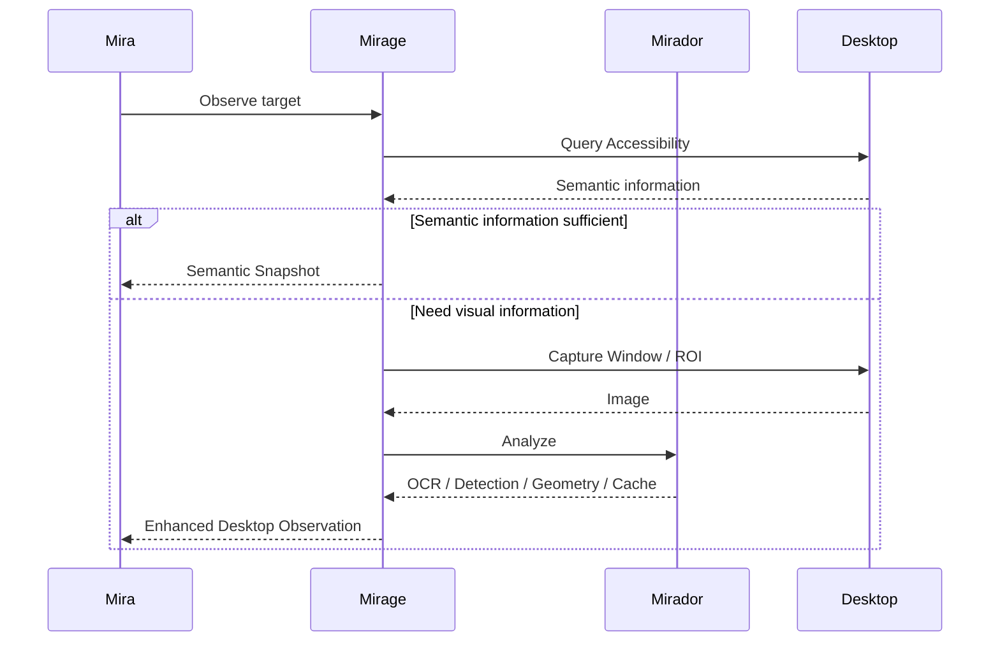

对于 Mirador 返回的视觉对象，Mirage 同样可以建立临时 Visual Reference：

```text
@v1 text "Start"
@v2 icon cache:settings
@v3 geometry closed-region
```

使 Agent 可以使用：

```text
click(@v2)
```

而由 Mirage 负责将 Visual Reference 转换为实际坐标和输入行为。

这样 Accessibility Element 与 Visual Element 在 Agent 层可以采用相似的引用机制。

## 9. 行为执行路径

桌面任务通常存在多种实现方式。Mirage 应向 Mira暴露当前环境可用的能力及其状态，让 Agent 能够选择适合当前任务的执行路径。

典型能力层次为：

```text
Tool / MCP
      ↓
Filesystem / Shell / Native Capability
      ↓
Accessibility
      ↓
Mirador Structured Vision
      ↓
Visual Localization + Input
```

例如读取配置文件可以直接访问 Filesystem；运行程序可以使用 Process Provider；标准桌面应用中的按钮可以通过 Accessibility 操作；Canvas、自绘应用或游戏中的对象则可以通过 Mirador 定位后执行 Pointer Action。

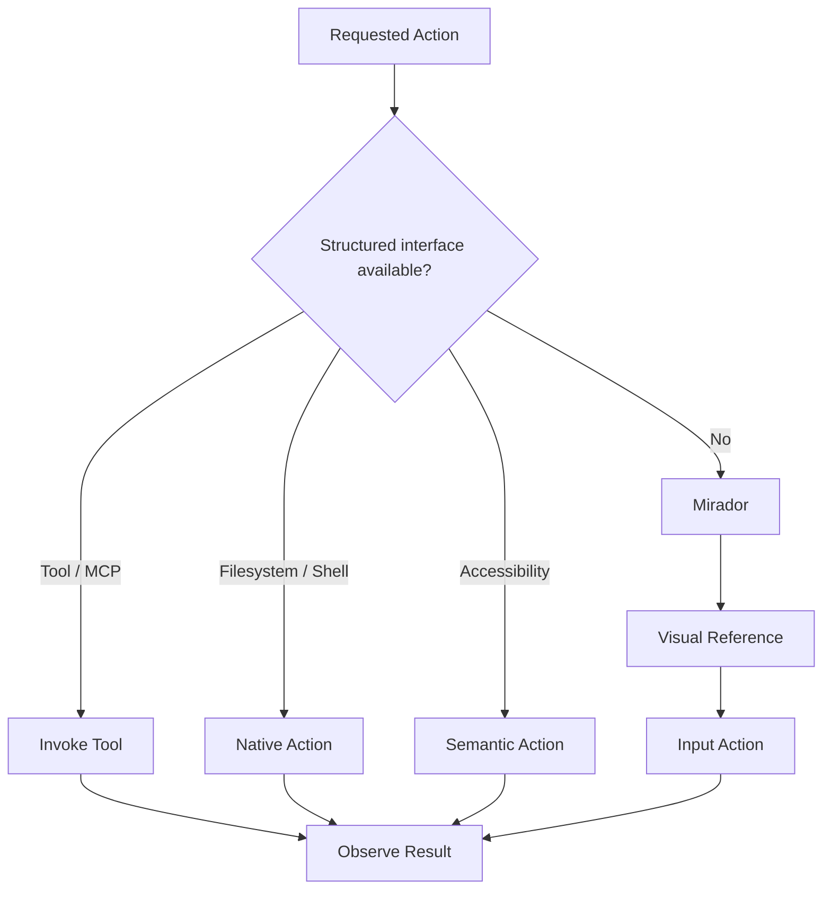

执行之后重新生成必要 Observation，由 Mira 判断任务是否继续。

## 10. Linux / Windows Platform Backend

Desktop Environment 通过 Platform Backend 屏蔽 Linux 与 Windows 的实现差异。

Windows 可以围绕 UI Automation、Win32、系统截图与输入 API 实现：

```text
WindowsBackend
├── UI Automation
├── Win32 Window / Process
├── Screen Capture
├── Keyboard / Pointer Input
├── Clipboard
└── System Integration
```

Linux Backend 则需要同时处理桌面 Accessibility 与显示服务器差异：

```text
LinuxBackend
├── AT-SPI2
├── X11 Backend
├── Wayland Backend
├── XDG Desktop Portal
├── Clipboard
└── System Integration
```

整体结构为：

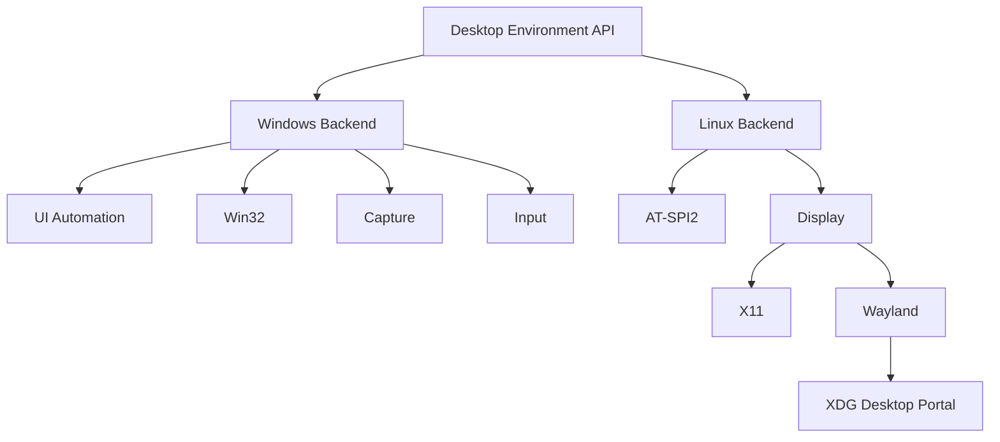

Backend 对上层返回统一数据结构，从而让 Desktop Observation、Element Reference 和 Desktop Action 在两个平台上保持一致语义。

## 11. Mira Runtime Integration

M7-01/02/03 按 [DEC-053](../decisions/DEC-053-conversation-desktop-tool-registration.md)
与 [DEC-054](../decisions/DEC-054-scoped-complete-desktop-actions.md) 复用 DesktopAtomToolset
向 ConversationLoop 每轮新 registry 注册四种观察、窗口激活、语义点击及完整 key/text。
Runtime Service 注入共享环境、权限与唯一 ActionCoordinator，初始装配和模型切换一致。
只读轮次仅保留观察；输入 Backend 未声明完整释放能力时不注册 key/text，语义 Provider
未声明 scope 核验能力时不注册 click。现阶段运行证据限定 Linux X11/AT-SPI2。

修改工具要求 window_id、observation_scope、environment_epoch，click 另要求当前语义
@e 引用。观察绑定轮次和会话，5 秒内有效；动作准入/结算及接管/恢复推进 epoch。
权限等待后重验观察，输入前核对前台和几何，Backend 同锁验证语义 scope；旧引用不能
回指新快照重名目标。共享 lease 无队列，另一会话或工作流输入返回 desktop_busy。
完整输入只释放自己按下的键/按钮，取消与超时不禁用清理。回执明确 input_released
和可能副作用；释放失败/不能确认释放的输入异常保持 fence，恢复拒绝，shutdown 报告失败。
所有路径仍由既有 Executor task 管理，并将 StopToken 桥接为 Provider CancelToken。

M7-04/05 按 [DEC-055](../decisions/DEC-055-desktop-image-supply.md) 接通标准 RGB8 PNG。
显式 supports_images 的模型才注册显示器枚举和 capture；逐次 screen.capture 权限
先于像素采集。display/window/ROI 返回来源、尺寸/全局原点、1:1 变换与 artifact
身份；规范 User ImagePart 经 Mira set_model_input_supplier 加入下一请求，原生工具
往返不变。单轮最新一张、4 次、raw/encoded 各 8 MiB、5 秒，几何/epoch/身份失配或
取消不发布，更新/过期/动作/轮次结束时退役；Source 使用 MemoryArtifactStore 与
kairo LatestMailbox，不另建循环、队列或 owner。Guard 阻止缺图/旧图的纯文本继续。

底层动作成功只表示 dispatched，不能证明业务完成。M7-08 首交付按
[DEC-056](../decisions/DEC-056-post-action-verification.md) 在会话 Adapter 固定修改前
声明的窗口/语义后条件，租约结算后强制新观察。复用 Mira 的观察质量/时间评估和
每请求 supplier，不自建 Agent 循环。只读 desktop.action.verify 可重验最近动作，
不重复输入；未验证或不确定阻止下一修改。终态再次采集，所有动作有条件证据且无
规范工具失败才能保留回答，并声明局部核验范围。工具卡区分派发与核验，含目标、
观察身份/摘要/时间。Linux X11 三类本地任务证据见
[后条件验证](../compatibility/post-action-verification-20261009.md)。
上述逐动作强制观察和全历史 verified 规则是历史实现；2026-10-20 已接受的
DEC-056 分层策略的 v2 首增量见第 5.1 节；原 M7-08 验收保留，不替代新策略的验证记录。
OCR/视觉编号属于 M7-06/07。不开放裸坐标或独立 down/up。公开示例、隐私与恢复边界见
[桌面动作安全契约](../security/desktop-actions.md)，测试证据见
[作用域与完整输入验证](../compatibility/scoped-complete-input-20261009.md)。

Mirage 需要提供一个稳定的 Mira Host，使 Mira 可以作为长期运行的 Agent Runtime 存在于桌面环境。

Mira Host 负责初始化 Mira、绑定 Desktop Environment、提供 Mirage 本地配置、连接 Tool/MCP 环境，并将 Mira 产生的任务状态和执行事件传递给 Mirage UI。

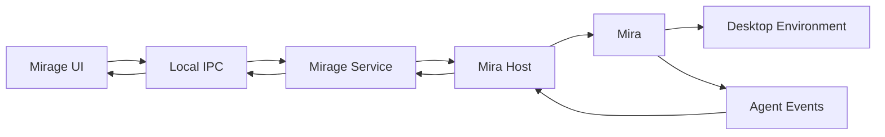

Mirage 不需要重新定义 Mira 内部的 Agent Harness 数据模型，而需要建立稳定的 Adapter，将 Mira 已有能力映射到桌面产品所需要的运行状态和 UI。

例如 Mira 提供的 Task、Workflow、Subagent、Tool Call 和 Trace 信息，可以通过 Runtime Integration 转换为 Mirage UI 可以订阅的事件。

### 11.1 Mira Host 生命周期与状态机（M1 冻结）

Mira Host（`runtime/mira_host`）是 pinned `MiraRuntime` 实例的唯一 owner：宿主负责按
顺序初始化（`initialize` → 绑定环境打开主会话 `open_session`）与关闭（`request_shutdown`
→ 等待排空 → `finish_shutdown`），不在 pinned 运行时之外另建并发设施。宿主状态集
自 M1 起冻结：

| HostStatus | 含义 | 后继状态 |
| --- | --- | --- |
| `Stopped` | 初始态与正常终态，未宿主 | `Starting` |
| `Starting` | `start()` 已接纳，pinned 初始化与会话打开进行中 | `Running`、`Failed` |
| `Running` | 已绑定环境，可提交任务 | `Stopping`、`Failed` |
| `Stopping` | `shutdown()` 已接纳，等待排空 | `Stopped`、`Failed` |
| `Failed` | 终态：初始化、绑定或运行失败 | （无，仅释放资源） |

约束：

- `Stopped` 与 `Failed` 是终态，幂等且不可复活；`start()`/`shutdown()` 在终态上只能
  失败关闭或重述已记录结果。关闭顺序必须闭合：任何成功初始化的 pinned 运行时实例，
  无论从 `shutdown()` 还是宿主析构离开，都经过 `request_shutdown → finish_shutdown`。
- 绑定接口为 `integration/mira` 的 `DesktopEnvironmentBinding`（不暴露 pinned 类型）；
  具体适配器的最终派生类型必须同时实现 pinned 环境契约，宿主在 `start()` 时以运行时
  cross-cast 恢复该契约，未携带契约的绑定按 `invalid_argument` 失败关闭。M1 的具体
  适配器是 `integration/mira::MiraEnvironmentBinding`：包装 `DesktopEnvironment`，
  pinned 感知/输入面按环境真实能力集如实适配（超集 fail closed、输入在任何副作用前
  拒绝、interrupt 幂等）；Filesystem / Process 经宿主操作面（`begin_operation` /
  `admit_operation_completion`）以 Mirage Provider 返回值暴露给宿主侧驱动循环
  （[DEC-008](../decisions/DEC-008-m1-environment-binding-and-reference-providers.md)）。
  `M2-06` 起 observe 面如实上报：capabilities 从绑定环境的 Provider 访问器推导
  （foreground_app ← window、ui_tree ← window + accessibility；input/
  atomicity/skew bound/epoch 各按其真实缺口保持未声明），required 的
  structure/foreground 映射到第 6 节的按需组装器并 fail closed，Semantic
  Snapshot 投影为 pinned `UiTreeSnapshot`（`@eN` 引用入 stable hint、映射后经
  pinned validator 复验）进入 Agent 观察面，optional 组件降级以 quality 记录
  显式呈现。`M3-05` 起视觉面接线：当绑定配置了视觉管线（采集 → 每源会话分析 →
  注册表发布，[DEC-016](../decisions/DEC-016-mirador-visual-integration-contract.md)）
  与 artifact store 时，`screen_capture` 与一个 perception 源可如实声明——
  screen 组件交付 store 记录完整的 `ScreenFrameDescriptor`（采集帧像素经 store
  发布，载荷元数据为唯一 wire 描述），perception 请求触发刷新并把发布代际投影为
  全局桌面坐标的 pinned 证据条目；required/optional fail closed 语义与
  structure 一致，未接线时视觉位保持未声明。discrete_input 仍未声明（pinned
  规范输入序列映射落地后再扩展）。
- 产品层可见的任务进度是 pinned `TaskState` 的 M1 投影：`Idle`；`Active`（Observing/
  Reasoning/Planning/Acting/Verifying/Recovering）；`Paused`（Pausing/Paused/
  TakeoverSettling/SuspendedForTakeover）；`Cancelling`；终态 `Completed`/`Failed`/
  `Cancelled`；`Unknown`（身份非法或不可表示）。终态幂等由 pinned 契约的转移表保证，
  迟到的完成或取消以可观察的拒绝呈现，不会复活终态任务。
- 单 owner 线程驱动宿主控制面（Runtime Service，见第 12 节）；`status()` 可被任意
  线程观察。pinned 运行时内部的 Executor 编队由 pinned 依赖自管，Mirage 以容量配置
  约束其准入与排队。

## 12. 后台运行

桌面 Agent 需要支持长时间任务，因此 Mirage Runtime 应独立于主窗口运行。

当前产品进程形态由 [DEC-045](../decisions/DEC-045-tray-runtime-owner.md) 固定：

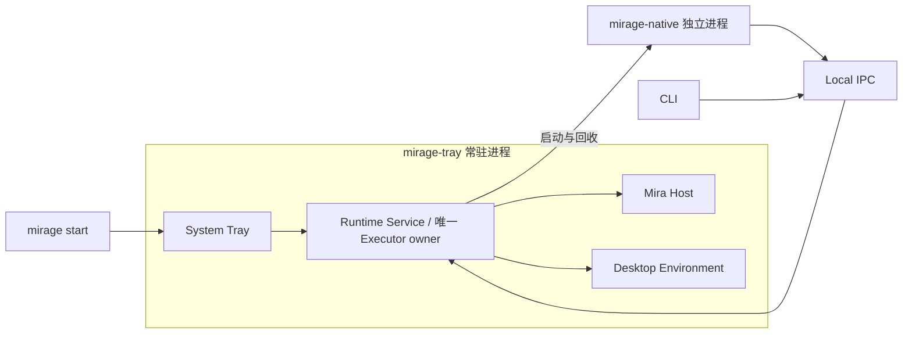

统一入口等待真实托盘注册，随后托盘启动前端。前端必须由在线托盘持有，创建窗口前
校验能力与子进程身份，宿主断开后退出。关闭主窗口保留任务与托盘；重复启动复用
常驻进程并激活窗口。托盘退出检查活动桌面任务、Agent 轮次与非终态 Workflow；有
活动时前端显示当前退出 epoch 的确认，取消保留工作，确认按现有取消和 shutdown
顺序结束 Runtime 与前端。托盘 SDK 回调只投递有界动作，业务经 Runtime Executor
串行化；窗口子进程创建/回收位于 Platform Backend。系统信号或宿主失败直接安全收敛。

Windows 安装的开始菜单入口使用 GUI 子系统 `mirage-launcher`，共享 `mirage start`
控制面；CLI 保留控制台，托盘进程也使用 GUI 子系统（DEC-045）。通知 Provider 的独立
Shell_NotifyIcon 承载以 NIS_HIDDEN 注册，常驻可见面只有产品主托盘（DEC-018）。原生
菜单为现有 Win32 pump 上的白色圆角 modeless 弹层，标准按钮保留可访问名称和禁用状态，
提供键盘导航、外部点击关闭、阴影和分组，字号、行高和留白按调用显示器 DPI 缩放。
无边框窗口仍使用每像素 alpha；bundled GLFW 在 WM_PAINT 初始化 DWM 重定向表面，
但该修补不能消除本机全部间歇黑角。私有 Windows 适配边界以与绘制一致的 12 logical px
窗口 region 保护产品四角，resize/DPI 时更新，最大化时恢复矩形。该整数裁剪会改变部分
系统阴影行为，不声明上游通用透明已解决；移除条件见升级审计。取证及新安装升级门禁见
[Windows 呈现维护计划](../plans/maintenance-windows-presentation-20261014.md)。

M8 规划新增由同一托盘 Runtime owner 持有的 `mira_pet` 独立子进程，作为主窗口之外的
常驻状态显示面；不承载第二份 Mira。它经 Local IPC 消费真实阶段及终态，主窗口关闭
后继续呈现，桌宠自身失败不取消 Agent。此拓扑扩展尚未实施，状态恢复、启动 bootstrap、
子进程准入和有界退出见 [DEC-084 提案](../decisions/DEC-084-mira-pet-process-and-animation.md)
与 [mira_pet 设计](mira-pet.md)，实施状态由 [M8](../plans/m8-mira-pet.md) 跟踪。

例如：

```text
mirage task list
mirage task inspect <id>
mirage task pause <id>
mirage workflow run <name>
mirage agent run <agent> "<goal>"
```

### 12.1 M1 落地形态（DEC-007）

M1 阶段 Local IPC 的落地形态由 [DEC-007](../decisions/DEC-007-local-ipc-and-runtime-service.md)
冻结（以下进程形态为历史基线；产品已由 DEC-045 替代，headless 开发入口保留）：

- **传输**：Linux 使用 Unix domain socket（默认
  `$XDG_RUNTIME_DIR/mirage/mirage-service.sock`，回退 `/tmp/mirage-<uid>/`，目录
  `0700`）；Windows（M4）以命名管道实现同一契约。帧格式为 4 字节小端长度前缀 +
  UTF-8 JSON（pinned mira 的 JSON 模型实现，公共 API 保持 pinned-free），载荷上限
  1 MiB，单连接同时至多一个未决请求。
- **协议 v1 请求面**：`hello`、`task.submit`、`task.list`、`task.inspect`、
  `task.cancel`（`M1-05`，[DEC-009](../decisions/DEC-009-provider-scope-budget-cancellation.md)：
  中断在途桌面动作并按 pinned 取消语义结算任务，被中断步标记 `cancelled`）、
  `service.shutdown`。`task.submit` 携带 goal 与可选有序 steps（M1 桌面能力：
  `filesystem.read` / `process.execute`），由 Service 内的宿主侧驱动循环逐个执行、
  以 `begin_operation` / `admit_operation_completion` 括起进入 pinned 控制面并记录
  step 的 operation id（Trace 关联）；驱动循环在动作副作用前按 [DEC-010](../decisions/DEC-010-m1-permission-framework.md)
  的 Permission Gate 判定 Capability 策略，决策以 `permission` 字段记录进
  `task.inspect` 的 step 视图；这是无模型循环阶段的过渡形态，与 DEC-008 的
  迁移路径一致。
- **进程形态**：Runtime Service 由 `apps/service`（`mirage-service`）托管，前台运行
  至 `service.shutdown` 或 SIGINT/SIGTERM；`mirage service start` 经 fork + exec
  拉起兄弟二进制并等待就绪。GUI、Tray、CLI 只经 Local IPC 与之交互。
- **并发承载**：Service 进程内由 RuntimeService 持有唯一的 `kairo::Executor`
  实例（`EXEC-01`）：IPC 事件循环为专属 blocking I/O worker，全部 MiraHost 操作经
  一个 SerialExecutionContext 串行化，任务驱动为可取消任务（step 间检查停止令牌），
  响应回投使用 `kairo::comm::MpscChannel`。任务取消（`task.cancel` 与有序
  停机）按 desktop cancel token → 驱动停止令牌 → pinned cancel 的顺序传播，
  使在途桌面动作有界中断（`M1-05`，DEC-009）。

### 12.2 IPC 事件订阅（M1.5，DEC-012）

协议 v1 的事件推送面由 [DEC-012](../decisions/DEC-012-ipc-event-subscription-and-wire-schema.md)
定义、随 `M1.5-02` 落地冻结，wire 契约见[《Mirage Local IPC 协议 v1 Wire Schema》](mirage-ipc-protocol-v1.md)第 7 节：

- **订阅面**：`events.subscribe` / `events.unsubscribe`（无参数，订阅粒度为连接，
  断连即失效）；事件帧 `{"v":1,"seq":N,"event":"<名称>",...}`，`seq` 每连接自 1
  单调递增；hello 响应以 `events` 能力成员通告（新服务端恒写出，旧服务端缺席，
  客户端据此降级轮询）。订阅建立后服务端先下发当前 host 状态作为首个事件
  （seed，seq=1）。
- **M1.5 事件集**：`task.updated`（任务创建、步进与终态的快照，progress 与
  `task.inspect` 同源）、`host.status`（宿主五态变化）、`events.overflow`
  （连接级队列溢出的合成标记，`dropped` 计数）。事件是通知不是可靠投递，
  `task.list` / `task.inspect` 快照始终是事实源。
- **承载**：RuntimeService 持有 `kairo::comm::Topic<EventPayload>` 作为多订阅
  广播点，host 状态以 `LatestMailbox` 语义（订阅 seed 取最新值）进入同一发布
  路径；每连接投递队列为订阅自带的 `MpscChannel`（有界、drop-oldest）。IPC
  循环每轮先写出响应帧、后写出事件帧（响应优先），溢出以 `events.overflow`
  显式呈现（`RULE-07`）；断连即销毁订阅并排空队列。任务发布点：任务创建
  （submit，serial 域）、取消受理（cancel，serial 域）、驱动步进与终态（驱动
  线程 best-effort 投递到 serial 域，拒绝或超时即丢弃该条通知）。

### 12.3 会话与消息契约面（M5，DEC-021）

会话与消息的协议承载由 [DEC-021](../decisions/DEC-021-session-message-contract-face.md)
定义、随 `M5-04` 落地，wire 契约见[协议 v1 Wire Schema](mirage-ipc-protocol-v1.md)
§4 / §6.4 / §7.2：

- **会话请求面**：`session.list`（注册表快照，含 `start()` 打开的主会话）、
  `session.open`（在 hosted pinned 运行时上新开会话，容量饱和 fail closed）、
  `session.history`（pinned 会话投影重建的对话历史，最新窗口 + `truncated`
  截断标记）。`task.submit` 以可选 `session_id` 绑定会话（缺席落主会话，M1
  wire 形态不变），回执携带归属。hello 以 `sessions` 能力成员通告。
- **会话事件集**：`session.updated`（会话入注册表）、`session.message`
  （对话投影新增条目：user / outcome）、`session.turn`（有界工作单元结算）、
  `session.output`（步结果输出增量）。快照事实源为 `session.list` /
  `session.history`，一致性模型沿用 DEC-012。
- **服务承载**：`MiraHost` 新增 pinned-free 会话面（开新会话、会话视图、按会
  话提交）；服务进程持有 pinned `MemoryEventStore`，经 integration/mira 的
  `SessionJournal` 适配器以 pinned 循环同款事件载荷记录任务目标与结算，历史
  由 pinned `build_conversation_view` 每次重建（存储是唯一事实源，投影可重
  建）。模型循环（pinned `AgentLoop`）落地后写同一存储，契约面无感——这是
  M1 过渡驱动形态向 pinned 会话 / 任务模型演进（DEC-008 迁移路径）的第一
  步；本阶段仍不引入模型循环，steps 语义不变。

### 12.4 工作流契约面（M5，DEC-023）

工作流的协议承载由 [DEC-023](../decisions/DEC-023-workflow-contract-face.md)
定义、随 `M5-05` 第一轮落地，绑定 2026-09-26 升级后的 pinned
`WorkflowRuntime` 契约面（[DEC-022](../decisions/DEC-022-upstream-capability-adoption.md)
决策 1 兑现），wire 契约见[协议 v1 Wire Schema](mirage-ipc-protocol-v1.md)
§4 / §6.5 / §7.2：

- **工作流请求面**：`workflow.list`（产品目录快照：head digest、validation、
  可运行投影）、`workflow.save`（草稿 = pinned `not_validated` 版本，可解析
  不可运行）、`workflow.publish`（pinned DryRun 门禁入库，内容寻址 + 幂等）、
  `workflow.delete`（产品目录条目移除；pinned 版本历史追加式不可变）、
  `workflow.atom.catalog`（宿主 BuiltIn 注册表 exposed view 承载，DEC-022：
  不自建第二套目录模型）、`workflow.runs`（运行状态快照事实源）、
  `workflow.run`（库路径准入 + 异步驱动）、`workflow.cancel`（幂等取消）。
  hello 以 `workflows` 能力成员通告。
- **运行监控事件化**：`workflow.run_updated`（run_id、workflow_id、状态、纪
  元、可选结算摘要）由服务从 pinned 工作流事件经 integration/mira 的
  `WorkflowEventBridge` 转译发布（`WorkflowRunStarted` → `running`、
  `WorkflowRunSettled` → 终态），不从服务侧推测状态；快照事实源为
  `workflow.runs`，一致性模型沿用 DEC-012。步级 / patch / 决策事件按 UI 消
  费需求以附加扩展进入。
- **服务承载**：`MiraHost` 新增工作流承载面——在 Running 宿主上构造 pinned
  `WorkflowRuntime`（绑定服务进程唯一 Executor、pinned 运行时、主会话与已
  绑定环境），服务 teardown 在 Executor 关停前先经
  `shutdown_workflow_surface()` 按 pinned 关闭顺序收敛（WorkflowRuntime
  shutdown → MiraRuntime 停止 → Executor shutdown）。服务侧工作流 / 运行两
  个内存注册表是产品索引（pinned 无库枚举 API），库与 Run 表仍是执行侧事
  实源；均为进程内易失形态，持久化随上游库存储（RISK-2026-038）与 DEC-011
  条目另行定案。
- **桌面原子工具集（M5-05 第二轮，DEC-024）**：integration/mira 的
  `DesktopAtomToolset` 在绑定环境的非空 Provider 上构建 pinned
  `BuiltinToolRegistry`（每 Provider 方法一个原子，Provider 缺席即不注册，
  目录如实反映能力；初始 13 项，观察读不经权限门、有词表条目的读写原子经
  `AtomPermissionGate` 回调缝接服务共享 `PermissionController`，RULE-05 与
  任务驱动同门）；宿主 attach 时经 pinned `set_tool_registry()` 安装，
  ToolCall 步由此派发真实桌面动作（副作用原子按 pinned W-02 须声明
  verification 谓词；DryRun 门禁只规划不派发），`workflow.atom.catalog` 由空
  目录转为 exposed view 投影。编辑器完整版接真实面与每版本工具引用挂载属
  `M5-05` 第二轮后续增量。

## 13. Agent Workspace

> **修订（2026-09-16，[DEC-013](../decisions/DEC-013-frontend-ia-harness-first.md)）**：
> UI 组织口径修订为 **harness 优先的统一壳**——会话（chat）是默认落地页，workflow
> 是一级导航中的平等入口；下文"采用 Agent Workspace 组织，而不是只围绕聊天历史
> 组织"的表述不再作为信息架构依据。本节描述的任务内组成（Conversation / 执行状态 /
> Workflow / Subagent / Tool Call / Trace）继续有效；页面级拓扑、风格规范与组件
> 规格以[《Mirage 前端设计规范与信息架构》](Mirage%20%E5%89%8D%E7%AB%AF%E8%AE%BE%E8%AE%A1%E8%A7%84%E8%8C%83%E4%B8%8E%E4%BF%A1%E6%81%AF%E6%9E%B6%E6%9E%84.md)为准。

Mirage 的桌面 UI 采用 Agent Workspace 组织，而不是只围绕聊天历史组织。

主要界面可以包括：

```text
Mirage
├── Agents
├── Tasks
├── Workspaces
├── Workflows
├── Tools / MCP
└── Settings
```

进入一个正在执行的任务后，可以查看 Conversation、当前执行状态、Workflow、Subagent、Tool Call 和 Trace。

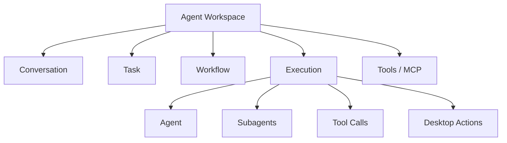

这些信息直接来自 Mira Runtime，Mirage 负责将其组织成适合桌面交互的产品界面。

Workflow 可以在桌面端获得完整的可视化编辑器，使用户查看节点、连接关系、参数和运行状态，并直接修改 Mira Workflow。

## 14. Desktop Overlay

当 Agent 正在执行桌面操作时，Mirage 可以提供轻量 Desktop Overlay。

Overlay 用于展示 Agent 当前关注的窗口或元素、即将执行的操作以及需要用户确认的行为。

例如当 Agent 通过 Accessibility 定位某个按钮时，可以在目标控件附近显示高亮；当视觉系统定位对象时，可以显示对应 Visual Region；当操作需要确认时，可以在当前工作位置直接显示确认入口。

```text
┌──────────────────────── Desktop ────────────────────────┐
│                                                         │
│        ┌───────────────────┐                            │
│        │      Save         │ ← Agent target             │
│        └───────────────────┘                            │
│                                                         │
│        Mirage: activating "Save"                        │
│                                                         │
└─────────────────────────────────────────────────────────┘
```

Overlay 同时可以用于调试 Desktop Observation，让开发者查看当前 Accessibility Element、Visual Reference 和 Agent 实际选择的目标。

### 14.1 mira_pet 状态窗口（M8 规划）

`mira_pet` 为独立透明置顶窗口，展示启动、待机、思考、观察、鼠标、键入、任务成功、
任务失败及退出；暂停、接管、确认与断连以明确文字补充。运行动画分别定义进入、
持续循环和离开区间，启动/退出当前采用单次播放，安全状态可立即打断。角色窗口与 Overlay 的目标高亮职责
分别保留。桌宠占位与输入目标或采集范围冲突时须避让/有界隐藏并重新观察，不能忽略
实际遮挡或把角色识别为桌面目标。当前 v3 九态素材中 looking/typing 已确认使用，
启动/退出临时使用待调整，以 once 播放并允许安全期限打断；素材状态和历史见
[M8](../plans/m8-mira-pet.md)。运行动画的精确循环区间和平台效果尚待验收。

## 15. 权限与桌面安全

Mirage 负责管理 Mira 对本机环境的实际访问权限。

权限按照桌面 Capability 组织，例如：

```text
desktop.observe
desktop.input
filesystem.read
filesystem.write
process.execute
clipboard.read
clipboard.write
application.launch
```

权限还应支持资源范围，例如允许某个 Agent 访问指定 Workspace，而不是整个用户目录。

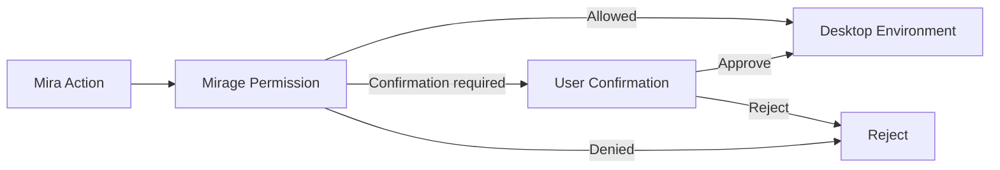

Mirage 将权限判断结果和用户确认结果返回 Mira，并将实际系统行为与 Agent Trace 关联，使用户能够追踪某一次文件修改、命令执行或桌面操作对应的 Agent 行为。

M1 阶段该判定以框架雏形落地（`M1-06`，
[DEC-010](../decisions/DEC-010-m1-permission-framework.md)）：`runtime/permission`
提供 pinned-free 的 Capability 词表（`filesystem.read` / `filesystem.write` /
`process.execute`）、每能力策略（`allow` / `confirm` / `deny`）与用户确认挂点
（默认 fail closed）。`M5-03` 起（[DEC-020](../decisions/DEC-020-permission-async-confirmation.md)），
确认挂点演进为 Local IPC 异步确认面：`confirm` 规则命中时经订阅事件
`permission.request` 广播待确认请求（含能力、资源、任务与剩余等待预算），任一
IPC 客户端以 `permission.respond` 应答（first-response-wins），等待预算耗尽、
表面饱和或任务取消均收敛 fail closed；`permission.list` 提供待确认快照作为
重同步事实源。判定语义、Capability 词表与确认结果四值不变。Runtime Service
的任务驱动器在动作副作用前判定，决策记录进任务步 Trace；Provider 层的路径
范围、预算与取消硬边界（DEC-009）不受判定结果影响、始终生效。默认策略保持
读取与执行放行、写入拒绝，收紧经显式配置。

## 16. 本地状态与持久化

Mirage 自身只持久化桌面产品运行需要的数据，例如本机配置、Workspace、窗口状态、平台权限、Runtime 状态和 UI 配置。

Agent Memory、Workflow 等由 Mira 定义和管理的数据继续通过 Mira 的接口访问。

Mirage 特有的持久状态可以包括：

```text
Mirage Local State
├── Application Settings
├── Workspace Bindings
├── Runtime Configuration
├── Desktop Permissions
├── Platform Configuration
├── MCP / Tool Connection Configuration
├── UI Layout
└── Runtime Recovery State
```

这种划分可以减少 Mirage 与 Mira 数据模型之间的重复。

### 16.1 M1 落地形态（DEC-011）

`M1-07` 落地上表中的两个条目，由 [DEC-011](../decisions/DEC-011-m1-local-state-persistence.md)
冻结文件布局与格式：

- **本地配置**（Application Settings / Runtime Configuration / Desktop
  Permissions 的 M1 可配置面）：`service.json`，位于
  `$XDG_CONFIG_HOME/mirage`（回退 `~/.config/mirage`）。内容为 IPC endpoint
  覆盖、Filesystem 读范围、逐能力 Permission 规则与确认挂点结果；M1 经
  `mirage-service --config` 显式加载，旗标逐项覆盖，服务不回写。
- **Runtime Recovery State**：`task-recovery.json`，位于
  `$XDG_STATE_HOME/mirage`（回退 `~/.local/state/mirage`）。记录已结算任务
  （终态、逐步状态、operation id、Permission 决策与结果摘要）；任务结算与有序
  停机时全量快照，服务启动时注水回注册表，使 `task list` / `task inspect` 跨
  重启可见。

两文件均为带 `schema` 版本号的 JSON 文档（当前 v1），编码复用 pinned mira 的
JSON 模型且只出现在 `runtime/persistence` 实现文件内，公共 API 保持
pinned-free；保存走"临时文件 + fsync + 原子重命名"，目录 `0700`、文件 `0600`，
并受明确字节预算约束（settings 64 KiB、recovery 4 MiB）。其余条目
（Workspace Bindings、UI Layout 等）随对应里程碑落地。

会话历史按 DEC-101 分别保存到 `sessions/<id>.json`（schema 1、每文件 8 MiB），
默认不限制会话个数。旧 `session-state.json` 在逐文件迁移完成后原子改为 schema 2
格式标记；删除写入空数组墓碑，损坏文件隔离保留且不覆盖。单文件原子性沿用本地
存储，不承诺跨会话事务。M6-43 / DEC-036
在会话内增加可选 `context_usage` 与 `context_usage_sequence`，持有最近成功模型请求的
输入 Token、当时窗口预算及模型 ID；成功缺用量和编辑替换推进序列并清空值，失败/取消
保留旧值。该快照独立于有界轮次历史，复用结算、替换及停机保存路径和现有锁所有权，
不新增任务或通信队列。重启后通过 `session.chat.history` 顶层快照恢复到原生 UI；
协议边界与旧文件兼容行为见 [IPC 契约 DEC-036](mirage-ipc-protocol-v1.md#dec-036可选上下文用量投影m6-06)。

## 17. 推荐代码结构

Mirage 的仓库可以围绕产品集成与桌面能力组织：

```text
mirage/
├── apps/
│   ├── desktop/
│   ├── service/
│   ├── tray/
│   └── cli/
│
├── runtime/
│   ├── mira_host/
│   ├── service/
│   ├── ipc/
│   ├── persistence/
│   └── permission/
│
├── desktop/
│   ├── environment/
│   ├── application/
│   ├── window/
│   ├── accessibility/
│   ├── observation/
│   ├── capture/
│   ├── input/
│   ├── clipboard/
│   ├── filesystem/
│   └── process/
│
├── platform/
│   ├── windows/
│   │   ├── uia/
│   │   ├── win32/
│   │   ├── capture/
│   │   └── input/
│   │
│   └── linux/
│       ├── atspi/
│       ├── x11/
│       ├── wayland/
│       └── portal/
│
├── integration/
│   ├── mira/
│   ├── mirador/
│   └── mcp/
│
├── ui/
│   ├── workspace/
│   ├── tasks/
│   ├── workflow/
│   ├── execution/
│   ├── overlay/
│   └── settings/
│
└── tests/
```

其中 `runtime/mira_host` 和 `integration/mira` 负责 Mira 的宿主与接口适配；`integration/mirador` 负责视觉请求和结果转换；`desktop` 定义跨平台 Desktop Environment；`platform` 实现具体 OS Backend；`ui` 构成 Mirage 桌面产品。

`ui/` 的实现形态由 [DEC-006](../decisions/DEC-006-ui-web-frontend-packaging.md) 固定：采用 Web 前端技术栈（HTML / CSS / TypeScript），经嵌入式渲染壳（CEF，M3-06 冻结，PoC 取证见[壳 PoC 基线报告](../benchmarks/shell-poc-baselines.md)）承载为独立的桌面应用进程——界面渲染在应用自有窗口中，不是浏览器网页。GUI、Tray 与 CLI 一致，仅经 Local IPC 与 Runtime Service 交互，UI 不进入 C++ 目标依赖图，IPC 契约是两者唯一的耦合面。分发形态为 Linux `.deb` 与 Windows `exe` 安装包；更新通道冻结：Linux 走 GPG 签名 apt 仓库、Windows 走签名应用内更新器（M3-06 复核冻结，差分/全量策略见 DEC-006 修订节）。`ui/` 的信息架构、页面拓扑与风格规范由 [DEC-013](../decisions/DEC-013-frontend-ia-harness-first.md) 冻结，见[《Mirage 前端设计规范与信息架构》](Mirage%20%E5%89%8D%E7%AB%AF%E8%AE%BE%E8%AE%A1%E8%A7%84%E8%8C%83%E4%B8%8E%E4%BF%A1%E6%81%AF%E6%9E%B6%E6%9E%84.md)；上方目录树中的 `ui/` 视图目录是该规范的实现承载划分，`ui/workspace` 等占位目录与规范页面的映射在实现时于 `ui/README.md` 维护。

## 18. 开发路线

Mirage 第一阶段应首先建立基础产品骨架和 Mira Host，在 Linux 开发环境中能够启动 Mira Agent、提交任务，并允许 Agent 使用 Filesystem、Process/Shell 等基础 PC 能力。同时建立 Runtime Service 与 IPC，使 Agent 可以脱离 GUI 生命周期运行。

第二阶段完成 Desktop Environment 的核心接口，实现 Application、Window、Accessibility、Screen Capture 和 Input，并首先打通 Linux Backend。此阶段应完成 Semantic Snapshot、Element Reference 和基础 Desktop Observation，使 Mira 能够稳定操作标准桌面应用。

第三阶段接入 Mirador，将 OCR、目标检测、几何结构分析和 Visual Cache 等能力加入 Desktop Observation，形成 Accessibility 与视觉结合的桌面感知能力，并完成 Visual Reference。

第四阶段完成 Windows Backend，使同一套 Desktop Environment API、Observation 和 Action 能够在 Linux 与 Windows 上运行。

第五阶段完善 Agent Workspace、Workflow UI、Execution Trace、Subagent View、Desktop Overlay 和权限管理，使 Mira 已有 Agent Harness 能力在 Mirage 中获得完整桌面产品形态。

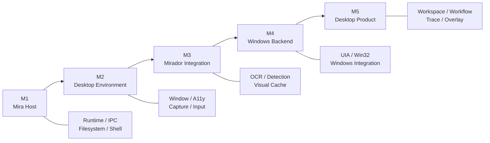

## 19. 总结

Mirage 要解决的问题，是将 Mira 已有的通用 Agent Harness 能力真正落入 Linux 与 Windows 的日常桌面环境，使 Agent 获得稳定的本机运行环境、桌面感知与操作能力，以及完整的桌面产品交互方式。

为实现这一目标，Mirage 以 Mira 作为 Agent Runtime 基础，以 Mirador 作为视觉基础设施，在自身内部重点建设 **Mira Host、Desktop Environment、Platform Backend、Background Runtime 和 Desktop Product**。

Desktop Environment 将文件、进程、应用、窗口、Accessibility、屏幕和输入等能力统一抽象，并通过 Linux / Windows Backend 实现平台适配；Mirador 负责将桌面视觉信息转换为 OCR、目标、几何结构和视觉 Cache 等低成本结构化信息；Mira Host 则将这些环境能力提供给 Mira，并把 Mira 的任务、Workflow、Subagent 和执行状态映射到 Mirage 产品界面。

最终的数据和控制关系可以概括为：

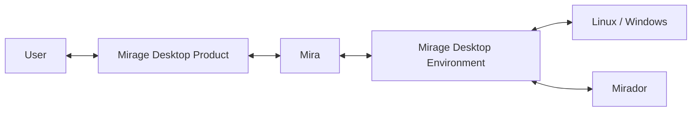

Mirage 由此成为 Mira 在 Linux / Windows 上的完整桌面宿主：用户通过 Mirage 使用通用 Agent Harness，Mira 负责 Agent 本身的运行与行为组织，Mirage 负责把这些行为连接到真实 PC 环境，而 Mirador负责为其中的视觉交互提供低负载视觉基础能力。

## M7-06 PP-OCR 产品根装配增量

按[DEC-057](../decisions/DEC-057-real-ocr-composition.md)，Runtime Service 在其唯一
Executor 初始化后，以有限任务核验显式清单并装配 pinned Mirador PpOcrBackend、
既有 VisualObservationPipeline / VisualSessionHost。关闭先收敛模型/任务生产者，再
停视觉 blocking worker，最后关闭 Executor 并释放后端/私有模型副本。无新增线程设施。
依赖方向 runtime→integration，公开 Runtime 配置只有路径，没有 ncnn/Mirador 类型。

同一 OCR 管线用于 Agent 的 desktop.vision.ocr 和 IPC visual observation；均经截图
权限、5 秒预算与显示器/epoch 核验。本文档原 MiraEnvironmentBinding 的 screen/perception
能力仍要求独立 artifact wiring；新 OCR 工具不扩大那个 capability 声明。盒子是视觉
证据；M7-07 的同源编号路径可选择目标，业务验证仍由 M7-08 条件证据负责。

M7-06 正式 pin 的公开语料字符与位置复验 4/4，Linux 首交付 Completed；宿主 DPI/
桌面、彩色多行与权重分发许可仍由后续门禁承接，见
[正确性记录](../compatibility/real-ocr-correctness-20261009.md)。

## M7-07 同源编号与视觉动作增量

按 [DEC-058](../decisions/DEC-058-scoped-visual-marks.md)，SoM 渲染/裁剪在已有视觉
worker 内完成，保留融合 region 顺序、generation 和 frame sequence，显示器到原图与
ROI 的变换均显式经 Mirador API。发布后的 scope/ref 与编号图绑定，图片沿用敏感
artifact/source/supplier；工具结果只含定位元数据，不输出 OCR 全文。

Runtime 向会话提供有界 mark 回调和 registry 同锁引用回调；公开接口仅使用 Mirage
类型。只在支持图片、配置真实 OCR、授权和能力齐备时暴露 mark；完整输入、窗口和
会话修改策略再决定 click 是否暴露。目标必须完整可见且位于当前窗口内，点击前
同显示器新采集像素严格一致（M7-16 起由 [DEC-083](../decisions/DEC-083-target-region-stability-reverification.md) 的目标矩形主体稳定判定承接：边距环动画忽略、核心区主体相似放行、不确定即拒）、显示器/窗口几何稳定，epoch/age/scope 均有效。通过
单写者 lease 执行完整 click，取消/清理失败和不确定副作用沿用 DEC-054/056。

新输入会退休本轮图和旧编号；完成仍取决于动作前固定的局部后条件与新观察。当前
窗口/语义后条件不升级为任意视觉业务证明。模板 evidence 复用已有 enrollment/probe
路径，未配置图标 backend 与真实宿主 Canvas 验收继续保留门禁；固定 OCR 条件见下节。
范围、复现和未执行项见 [验证记录](../compatibility/scoped-visual-marks-20261010.md)。

## M7-07 固定 OCR 文本条件增量

按 [DEC-059](../decisions/DEC-059-visual-text-postconditions.md)，会话修改工具可在派发
前固定 visual_text_exists/expected_text。新观察经服务 screen.capture 授权，再调用
既有 OCR 回调；Runtime 回执补显示器全局几何与请求内单调采集区间，backend 计数
递增、scope 不复用，源/模型身份在动作内固定。每次重验与终态都重新截图识别，
完整位于目标窗口内的唯一高置信度 OCR 精确匹配才通过。五秒协作期限、64 次轮内
预算、固定条件及取消/焦点/几何/epoch 检查在 Adapter 内完成，复用既有 worker。

四个窗口/输入工具 2.2.0、视觉点击 1.1.0；其他 required 字段不变。过程投影删除
expected_text，仅发布条件/观察 digest 与视觉来源身份。该条件只证明局部可见文字，
不推断任意用户意图或点击因果。实际 Xvfb Canvas 正/负例 5/5，详见
[验收记录](../compatibility/visual-text-canvas-20261010.md)；在线模型选号、用户宿主、
图标装配与高分辨率局部采集继续由 M7-07 承接。


## M7-07 无文字闭合区域编号增量

按 [DEC-060](../decisions/DEC-060-geometric-visual-marks.md)，既有 OCR manifest
可显式开启 geometry_marks。VisualObservationPipeline 在 marked refresh 中复用
VisualSessionHost 的 Mirador 几何阶段，经 EvidenceSet/fusion/SoM 发布候选；没有
新增 Detector、matcher 或 worker。普通 refresh/固定 OCR 后条件不启动几何阶段。
空文本 OCR 不加入融合；面积超过整帧 1/4 的提案保留在原始分析回执但不加入产品
编号候选，防止窗口容器吞并内部目标。数量预算仍在筛选前验证。

几何对象没有按钮角色、模板身份或可交互声明。既有编号点击校验与固定后条件保持；
实际 Screen/XTest/PP-OCR 的无文字 Canvas 正负例由
[验收记录](../compatibility/geometric-visual-marks-20261010.md)取证。产品模板资产装配见下节；
无闭合轮廓图标仍待验，不把 VisualIndex 的 patch 匹配误作整帧定位能力。


## M7-07 本地模板资源增量

按 [DEC-061](../decisions/DEC-061-geometric-template-resources.md)，显式 OCR manifest
可配置最多 16 个审核过的本地 BGRA8 patch，总像素不超过 4 MiB。有限装载任务先
检查类型、尺寸、精确字节数与 SHA-256，再装配模型；清单和摘要进入已有 revision。
配置拥有像素，首次模板 mark 在现有 serial blocking worker 注册 Mirador 索引。
后续仅在 DEC-060 合格几何提案的 tight patch 上 probe；普通 OCR 不启动模板。
32×32 指纹、64 KiB index、0.95 阈值和覆盖整个库的候选预算不增加调度或匹配设施。
取消、期限、注册/匹配失败、拒绝与 shutdown 经现有 future/owner 结算。

mark 1.1.0 映射增加 template_id，无匹配为空；与 OCR 混合时保留真实 OCR 文本
来源。全库任意其他强命中、融合区域内不同身份/位置、融合扩大模板框时不发布
身份，保留几何/文本候选。配置库不接纳帧 enrollment，避免隐藏额外资产或候选
截断。身份只是图像相似证据，不能作为 click 的输入引用；scope/编号、新截图、
固定窗口、权限与后条件门禁保持。公开自绘双模板、位置交换和不重绘负例由
[验收记录](../compatibility/geometric-template-resources-20261010.md)取证。无闭合
轮廓、跨主题/尺度、用户宿主、完整 4K/DPI 及完整权重 TSAN 期限仍待验；
受控在线选号与局部预采集的取证分别见下节。


## M7-07 在线编号选择验收增量

复用 DEC-055/058/059/060 的现有契约，实际 MiniMax-M3 / Messages / adaptive 已经
在私有 Xvfb 公共 Canvas 执行 mark→同源编号 click→只读 verify→终态新 OCR。
无 template_id 提示，两次位置不同的交叉图案由图像选择；正例与不重绘失败门禁
3/3，详见[证据](../compatibility/online-visual-canvas-20261010.md)。ModelLayer 使用
既有 Mira 生产 Provider/传输，不注入模型答案；Canvas 测试事件有界处理并归入
原 harness 的有限任务，未引入调度设施。三十秒 owner 与五秒图/引用/观察期限
保持。单个模型的受控样本不能替代用户宿主、其他模型或目标平台验收。


## M7-07 局部预采集增量

按 [DEC-063](../decisions/DEC-063-regional-visual-pre-capture.md)，显式清单可设置
roi_capture=true，mark 的 crop/窗口范围先由 ScreenProvider::capture_roi 采集，
再由现有 Mirador session 分析并编号。capture_roi 描述原像素全局范围，display
identity/布局不变，坐标变换来自 ROI 原点；无 crop 或默认关闭仍整屏。mark 1.2.0
保持参数/输出形状，编号属于本次分析；同源 click 重采同范围，继续逐像素和
窗口/显示器/前台/年龄/epoch/租约校验。显式 refresh_region 供 owner 装配局部 OCR
后观察，保留全局 bounds；未新增调度或匹配设施，预算不提高。4K 上的 480×180
公共窗口范围单独取证于[记录](../compatibility/regional-visual-capture-20261010.md)，
不能替代完整 4K、DPI/跨屏、用户宿主或目标平台声明。

第九增量使用既有 Mira Disabled/Adaptive 思考配置做显式验收选择，产品默认值
保持。输入前再次 mark 退休旧图片/scope，要求新图重新选号并消费原采集预算；
刷新不能解除已拒绝或不确定动作的终态门禁。工具阶段时间只是现有过程事件的
有界诊断投影，不记录思考内容、不另建任务监控。实际配置与样本限制见
[模型视觉耗时取证](../compatibility/model-visual-latency-20261010.md)。

## M7-20 完整点击序列（2026-10-18）

按 [DEC-099](../decisions/DEC-099-complete-double-click.md)，共享、区域和编号点击
增加可选 `click_count=1..32`（默认 1，2 为双击，3 为三击）。同一权限/目标守卫和单写者 lease 内完成
指定数量的按下/释放，之后统一产生新观察；不在各次点击之间调用模型、采集或重复授权。
InputProvider 的 `click_sequence_at` 缺省只转发单击，多次点击需后端显式实现；共享
输入通过 `SharedInputAction.click_count` 传递。Linux X11/Portal 直接复用既有
有界 Executor 调用，不新增调度设施。取消/失败仍释放已拥有按钮，部分成功不得
自动重试；语义 Invoke 保持一次激活，不能等价替代物理双击。

## M7-21 统一鼠标动作（2026-10-18）

按 [DEC-100](../decisions/DEC-100-unified-pointer-actions.md)，编号、图片区域和共享输入
均提供点击、滚动与完整拖动；点击/拖动使用相同的 button（left/middle/right，默认 left），
滚动使用相同的双轴轮步（正数右/下，绝对值总和 1..16）。图片区域新增 scroll_region、
drag_region，共享输入新增 drag，均经过同一权限、scope/epoch、新帧目标重验和动作后条件。
InputProvider 的 drag_with_button 保留 drag_to 左键兼容；X11 用选定按钮的所有权位处理
逐步检查与释放，Portal 在原有限动作中维护按下/释放账本。没有新增并发路径。
X11 拖动仍绑定同一前台窗口，Portal 绑定同一授权 monitor；16 段线性路径最多 2048 源
桌面像素、一秒协作期限。任意轨迹或跨窗口 X11 拖放需独立观察/权限契约，不把当前线性
手势宣称为这些能力。Windows 完整动作与真实 Wayland 平台验收保持独立。

## M7-09 有界滚动与完整拖拽首增量

按 [DEC-064](../decisions/DEC-064-bounded-scroll-and-drag.md)，InputProvider 新增
独立 opt-in 的 `scroll_at` / `drag_to`。`PointerActionScope` 只含窗口 ID 和观察
时几何，`PointerPoint` 使用全局桌面像素；模型工具只接收 scope/编号，不接收坐标。
Runtime 装配双引用回调，由 registry 在一次锁定内验证起点与终点，避免换代混用。
既有完整点击能力不隐含新能力；未提供 capability 的平台不注册两个新工具。

`desktop.vision.scroll` 1.0.0 的两轴离散步总量为 1..16，正数右/下、负数左/上；
不承诺像素距离。`desktop.vision.drag` 1.0.0 为同快照两编号间的完整左键操作，
非零欧氏距离最多 2048 像素、16 段线性路径。单动作协作预算最多 1000 ms，并
受 Task deadline 和五秒引用剩余寿命限制；不暴露持键续接，不在按住期间等模型。
权限、原四次采集、同范围逐像素与窗口/显示器核对均复用既有路径。

X11 Backend 在每个移动/轮步边界核对窗口几何、前台和指针归属，预先检测 core
1–5 号按钮及 Ctrl/Alt/Shift/Super。只释放本次尝试按下的按钮；取消、超时或
外部变化后的清理忽略停止请求，释放不确认则 fence。X 查询/注入不构成原子
事务，core 查询不覆盖扩展按钮按住状态；OS 往返没有硬实时上界。

新工具进入已有 mutation 记录、动作后观察、只读 verify 和宿主终态门禁。
派发成功仍需动作前固定的局部后条件，旧 epoch/编号退休；失败不能用重拍恢复。
私有 Xvfb 实际轮步/拖拽与 Mira fixture 正负例见
[验收记录](../compatibility/bounded-scroll-and-drag-20261010.md)。Windows/原生
Wayland、真实宿主应用、语义拖拽与跨屏/DPI 不包含在此次支持声明中。

GTK 原生控件效果增量验证双轴实际 adjustment 与分隔条 130→190 的位移，候选
仍为控件分配 fixture，未声称 OCR 质量或模型选择。X11 完整拖拽各运动使用
XTest 原生 8 ms delivery delay，归入同一 Executor 有限动作预算；清理 release
零延迟，不新增计时/调度设施。列表 XDND 拖放图层触发 target_obscured，兼容性
仍开放；不凭图层类型/标题/PID 绕过归属。准确范围和负例见
[原生应用效果证据](../compatibility/gtk-pointer-effects-20261010.md)。

M7-09 第三增量采用 [DEC-065](../decisions/DEC-065-x11-drag-helper-ownership.md)：
Platform Backend 可选链接系统 XRes，按下前保存有界可见根窗口和服务端连接
资源范围，持左键期间最多跳过一个新出现的同连接 InputOutput override-redirect
图层。其下方首个命中必须沿有界层叠几何解析到达原目标；不能跳过其他连接、
已有可见图层、普通窗口或第二辅助图层。重父窗口内部遮挡与容量超限仍拒绝。
缺开发包/编译关闭/服务器无扩展保持严格拒绝；公共 Provider 和工具契约不变。
原生列表正例与取消、焦点/遮挡失败取证见
[验收记录](../compatibility/x11-native-dnd-20261010.md)，不推定实际 pointer grab
接收者或业务成功，不承诺同连接内恶意隔离或 X11 查询/注入原子性。

后续用户 Xorg 上的 GTK 2× 控件验收沿用上述产品路径，测试候选几何先从 GDK
逻辑坐标转物理像素，经人工点击/松键后再捕获自有窗口 ROI；有限 driver
确认实际前台和显式窗口 ID，不在宿主强制激活窗口。滚动/重排与禁用/取消
四类分别取证，间歇像素变化和较晚取消前遮挡失败仍开放，见
[宿主记录](../compatibility/user-host-gtk-pointer-20261011.md)。本增量不扩大公共
契约，不将整数 2× 结果推广到任意 DPI/跨屏或在线 Agent 任务。

## M7-12 桌面视觉产品入口

按 [DEC-066](../decisions/DEC-066-product-desktop-vision-settings.md)，产品托盘启动时
显式探测 Linux X11 / AT-SPI2 / Application / Notification Provider；缺平台服务时保持
能力缺失。原先 Runtime 工具已装配而产品根未启用 Provider 的差异在此处闭合；不把平台
类型暴露到 DesktopEnvironment 或 Agent 行为层，headless 默认不随产品改变。

`native-vision-debug/release` 显式包含 PP-OCR backend，普通 native 构建仍默认关闭。
原生「桌面工具」页通过现有 Runtime IPC owner 读写本地资源清单，保存合并既有设置，
与当前管线状态分开投影，重启托盘 owner 后生效。CLI 启动覆盖只传递给新进程；已有
托盘明确拒绝该覆盖。坏资源可用空覆盖启动并修正设置，不绕过权重校验，不热切换管线。
模型「识图」仍按模型声明启用；会话权限和工具执行契约沿用 M7-01～09。协议与操作步骤
分别见 [IPC 契约](mirage-ipc-protocol-v1.md)和[原生指南](../../apps/native/README.md)。
本项提供 Linux Xorg 产品预览入口，任意应用、其他平台及本地知识/workflow 组合另验。

## M7-11 本地语义 Workflow 首增量

[DEC-067](../decisions/DEC-067-local-semantic-workflow-grounding.md)通过现有 DesktopAtomToolset
追加 workflow 专用 `desktop.knowledge.activate`。知识保存在 Mira IR：应用、页面、目标角色/
名称与固定后条件；执行引用、scope、坐标和 epoch 都不作为持久知识。执行时取得新语义
快照，精确且唯一解析启用目标，再沿用权限、作用域、动作 lease、前台/几何/标题和取消
门禁激活一次；后条件必须在前观察中不存在，并在同应用/页面的新观察中唯一出现。

任务、版本、失败升级和关闭继续由 Mira WorkflowRuntime 与既有 Executor owner 承载；
没有新线程、调度器或平行知识事实源。五秒组合预算/一秒新语义核验是协作式期限，不是
对平台阻塞调用的强制终止保证。成功回执为 canonical JSON 字符串以适配标量 step_result
谓词，宿主只在证据成立时返回 verified=true；DryRun 发布不代表真实执行验证。

Strict 失败闭合，Recoverable 交为 WaitingAgent，首增量不自动重发或调用模型恢复；
原生会话选择、跨重启自动恢复、AppModel 多页导航以及 Mirador OCR/模板目标留待后续。
当前产品可经既有 workflow CLI/IPC 使用，真实 GTK/AT-SPI2 验收与其他平台边界见
[验证记录](../compatibility/local-semantic-workflow-20261011.md)。

### DEC-068 默认视觉运行包与拒绝恢复（M7-13 / M7-14）

Linux 原生产品构建自带固定 PP-OCRv5 / ncnn CPU 资源；没有 vision 设置时自动选择
随包清单，CLI、自定义或显式空清单优先。模型准备发生在构建期，运行时无下载；
32 MiB 原始采集预算、8 MiB PNG / ROI 输出预算、五秒观察有效期各自独立。只读
窗口/显示截图经 Mirador resize_area 生成最长边 1600 预览，元数据明确两轴坐标比例，
不产生动作引用。语义会话快照预算为 4096，仍明确拒绝超额，无语义树转视觉 ROI。
宿主自身证明未派发且无副作用的拒绝，允许新观察后修正；未知失败和不确定/未验证
派发保持封锁。经典 X11 标题按编码转 UTF-8，不向 IPC 发布坏字符串。详见 DEC-068。

DEC-070 补齐拒绝恢复的传输边界：Mira 的工具错误摘要上限为 512 字节，Mirage 向
canonical 历史回填有界完整 JSON，产品过程与历史的完整 verification 单独从本轮
宿主记录投影。参数错误返回字段名；无关空 expected_* 视为未声明，非空错配仍拒绝。
收尾只依据 canonical 历史与拥有的动作记录，已验证的纠正不被旧失败卡片再次否定。
编号预算错误明确 capture/analysis/publication/environment 和缩小 ROI 的处理建议；
空编号不产生目标。未知、伪造、派发后未验证或不确定失败继续封锁，见
[恢复验收](../compatibility/desktop-rejection-recovery-20261011.md)。

### M7-11 本地视觉目标（DEC-069）

workflow-only desktop.knowledge.visual_click 以精确 OCR 文本或已装配模板 ID 保存目标，
以前台窗口标题及唯一 page_text 固定页面。每次执行重新经现有 Mirador 管线取窗口 ROI、
解析唯一且有置信度的候选，复用编号动作的授权/像素/epoch/scope 门禁，仅点击一次。
后观察必须以新 OCR 证明唯一 expected_text 及 page_text；知识不保存坐标或执行引用，
不创建新 workflow 引擎。契约与预算见 [DEC-069](../decisions/DEC-069-local-visual-workflow-grounding.md)。

产品周期维护 callback 在四 worker 装配下限制同时一个等待串行处理，重叠 tick 有界
结算，避免维护等待占满 workflow 驱动/监视所需容量。已有 callback 消费 future，
读取最新产品状态，异常进入 Executor 周期失败，停止/取消/排空顺序不变（DEC-069）。

### DEC-071：会话应用交付与持久凭据

ApplicationProvider 增加可选 supports_open_uri/open_uri，默认 unsupported；Linux GIO
实现固定 desktop entry 的单一 HTTP(S) 参数交付，运行中也可接收。ApplicationLaunchOutcome
新增 side_effect_may_have_occurred，失败不能隐藏已派发进程。URI 子进程为有容量的
平台资源登记，和普通启动共用 256 项，不创建调度、队列或后台 worker。公开接口不含
GIO 类型，Windows 不宣称有 URI 能力。会话应用列表颁发独立 scope/epoch/五秒时效，
应用动作使用既有权限、ActionCoordinator 与 Executor 工作单元。局部后条件固定
application_running；窗口归属、页面和业务成功要由后续新观察证明。

系统凭据保持 Secret Service 引用模型。删除已不存在条目成功；读取缺失/锁定/歧义
有不同诊断。新写入不使用已知 GNOME 临时 session 集合：默认指向它时选择服务枚举
的持久 login，锁定或缺失则失败。已有临时密钥需用户在新版重新保存一次，不自动
改写真实密钥/配置/历史。API Key 读取失败与远端认证拒绝不同，不能称 Key 已失效。

### DEC-072：通用 GUI 路线（M7-15）

会话快捷工具是优化路径，缺失/明确未派发时应考虑语义、视觉、键盘等价路线。图片
适配新增绑定源截图的区域动作，复用 Mirador 公开坐标变换及统一 Provider/Input owner，
支持 window/display 上下文；显示上下文可覆盖当前前台窗口之外的启动器/菜单。
供图与动作意图区分：供图五秒新鲜，已供图区域可在六十秒内经新截图局部像素核对后执行；
不追踪移动对象、不续期编号，不把旧图当作后条件。新增前台变化/标题及显示范围 OCR
局部条件，使跨窗口 GUI 推进可验证；最终页面和业务目标另验。运行上下文仍由现有
Executor 与 Mira ConversationLoop 拥有，不增加平台类型、并发 owner 或持久执行坐标。
M7-11 的本地知识新解析继续承载重复目标定位，不能由区域像素匹配宣称其会话资产选择
已经完成。[决策](../decisions/DEC-072-general-gui-fallback.md)。

### DEC-073：原生 Wayland 授权观察（M7-10 首增量）

ScreenProvider 增加默认拒绝的 capture_desktop 和 desktop_observation_only 查询；
Linux 在自动选择的 Wayland 会话使用私有 PortalScreenBackend，窗口/输入/剪贴板
Provider 不宣称 X11 全桌面能力。显式私有 X display 仍用于 Xorg/Xvfb 验证。

平台在授权前选定 ScreenCast/PipeWire；Portal 或构建缺少 ScreenCast 能力时如实返回
unsupported_capability，不回退到需要人工点击的交互截图（见
wayland-capture-failclosed-20261014 记录）。前者拥有一次性
Session，有限 Executor 调用中推进 GMainContext 与 pw_loop，第三方回调只接纳有界
协议状态/一个 buffer，业务解码与供图在回调外进行。取消/超时/撤销/异常都关闭请求、
Session、stream/core/context/loop 与私有总线连接；不保存恢复 token 或授权资产。

观察图片复用现有 Mira ImagePart/PNG 内存资产和 Mirador resize_area；没有全局坐标、
image_scope、可执行 VisualReference 或 ROI/SoM。授权等待不计入五秒供图期限，元数据
使用 received_at_ms，capture_timestamp_known=false，不能冒充真实采集时刻。每轮一次
授权；失败保留可操作错误并避免重复提示。SDK/PNG/PipeWire 类型仅在 Platform 内。
输入及持续会话映射另行冻结，见[DEC-073](../decisions/DEC-073-wayland-portal-observation.md)。

### DEC-074：任务内共享与延迟后的目标重验

DesktopImageTurn 通过纯 std 的 DesktopCaptureSession 持有本轮 Platform 私有共享；
ScreenProvider 默认不支持，创建不弹授权。ScreenCast 成功后保留专属总线、Session
和 node，复用任务内单个 PipeWire consumer，调用方在有限循环内推进取帧；
没有后台 worker 或循环，任务结束关闭 consumer/session。任务对象持有 DesktopToolContext 的
环境 owner，先析构会话，再释放环境；会话禁止跨任务共享或并发调用。

按 [DEC-107](../decisions/DEC-107-capture-cadence-and-presentation.md) 不设任务累计帧数上限，
每次重新检查权限；首授权失败不重复，后续共享路径失败、取消或授权代际失效
关闭会话。ActionCoordinator 的 environment epoch 淘汰旧图，authority_epoch 则只在
接管/恢复/释放失败变化，fenced 时为零；普通动作后允许读取新图。新鲜证据五秒期限与
输入引用安全边界不变；已供给的交互规划意图可在原 60 秒本地重验窗口内保留历史预览，
不作为新鲜完成证据。系统首次授权最长 30 秒，后续单帧最长五秒。

application.list 候选绑定最新 scope/session/task/environment_epoch，最多 60 秒；
派发前及权限等待后调用已有 ApplicationProvider 本地重新枚举，精确核对同一安装 ID。
消失/重复/超时/枚举异常/接管/取消安全拒绝，不改选目标。终态仍不允许把无副作用
拒绝当成功，但为它提供与不确定派发不同的诊断。见
[DEC-074](../decisions/DEC-074-task-scoped-wayland-observation.md)。

### DEC-075：原生共享帧 OCR

原生 ScreenProvider 不提供全局显示坐标时，configured-display OCR 不注册。Runtime
通过 DesktopToolContext 的纯 std ImageOcrOutcome 回调，把当前任务的新预览图送入
同一 PpOcrPipeline/VisualObservationPipeline 的 read_image_ocr 接口，复用已存在的
Mirador PerceptionSession 与 Executor blocking worker；不枚举显示器、不创建第二个
推理实例、不发布 VisualReference 或修改全局 registry。任务持有共享 owner。

共享授权最长 30 秒、新帧最长五秒，取得新图后再起算最长五秒分析；每次检查权限、
epoch、取消和 authority_epoch。超时后仍存活的后台请求只持有按值取消上下文和已复制
图像，不捕获任务对象或栈变量。恢复必须新观察；接管/终态关闭共享，Runtime owner
回收现有 worker 后关闭 Executor。

OCR 区域为最长边 1600 预览的 image_pixels，<=128 段、单段 <=1024 字节、总 JSON
<=16 KiB，返回同源 artifact、epoch、尺寸、模型版本与调用计数。文本模型仅取得 OCR，
识图模型同时供给同源 ImagePart。文字作为不可信观察，普通持久日志只写摘要。
读图与输入能力分开说明；被本产品遮挡时请求用户移开窗口，不能伪造自动点击。
见 [DEC-075](../decisions/DEC-075-native-shared-frame-ocr.md)。

### DEC-076：OCR 预算与取图阶段

原生 OCR 只对已通过文本/几何门禁的结果应用 JSON 总预算：原序完整区域前缀，
truncated/total_region_count/region_count 明确覆盖范围，不切断 UTF-8、不发布引用。
原生检测候选固定 <=512，X11 保持 128；验证后最多映射 128 区域。
单段超限、非法几何、超过 512 候选仍拒绝；总量截断不证明文字不存在。
Platform 内取图失败附 remote/stream 阶段与有限流状态/格式/缓冲标志，不记录平台
原始错误或画面；五秒上限、失败关闭与任务内不再次授权保持。真实流超时需继续
取证，不能把新增诊断描述为已修复超时。见
[DEC-076](../decisions/DEC-076-bounded-native-ocr-and-capture-diagnostics.md)。

### DEC-077：任务内 Wayland 输入边界（M7-10）

ScreenProvider 的 desktop_interaction_supported / create_desktop_interaction_session
是能力声明和任务 owner 工厂；创建不授权。DesktopCaptureSession 通过平台无关
SharedInputAction 提供完整 click/key/text/scroll 与 InputOutcome，输入坐标为帧内像素。
Linux Portal 后端私有地映射为 Start 返回 size 的流内 compositor 坐标，拒绝缺失映射
或设备授权。Window/Input 全局 Provider 继续缺失，不伪装 X11 坐标或焦点身份。

Mira DesktopImageTurn 拥有会话，授权同任务 source=desktop 的 screen.capture / input.inject；
通过图像已供给证明、task/session/epoch/authority、60 秒意图和动作前目标矩形重验（逐像素承诺由 [DEC-083](../decisions/DEC-083-target-region-stability-reverification.md) 修订为主体稳定判定）
保护输入。普通动作保留共享但淘汰旧图；接管/取消/共享路径失败关闭会话。
DEC-107 删除前置重验、后置取图及只读截图的累计帧数额度，仍保留单帧内存、单次时间和
权限/取消边界。成功动作直接返回后置观察的 image_scope，后续输入不必额外重截。
桌宠租约仅覆盖实际采集/输入派发，授权/编码/OCR 不隐藏；平台限制和验证见 DEC-107。
当前 Portal 文本最多 4096 字节 printable ASCII，
禁止控制字符；非 ASCII 返回 text_transport_unavailable，无部分输入。按键通知不证明
输入法/应用已消费文字。会话复用单个 PipeWire consumer、最多一张 pending buffer；
私有循环由调用者推进，consumer 在 Portal session 前关闭，静态画面超时仍显式失败。

DesktopActionVerification 的 shared_frame_observed 证明输入释放和新帧取得，
shared_text_exists 从同一任务新帧复用 Mirador OCR 验证声明文本；不保证焦点身份或页面
业务完成。产品 DesktopEvidence.shared_desktop 显示共享目标和局部证据。取消 probe
由 ActionCoordinator 在锁外调用，状态/epoch 仍在锁内准入；Backend 每个输入步骤
检查协作取消，释放绕过已取消的动作 deadline。没有新增 worker、调度器或依赖 pin。

设计与验收：[DEC-077](../decisions/DEC-077-wayland-task-scoped-input.md)、
[验证记录](../compatibility/wayland-task-input-20261011.md)。

### 设置中的桌面授权恢复（DEC-078）

ScreenProvider 追加平台无关的授权状态、配置偏好和管理接口；具体 Portal 协议与
钥匙环存储留在 Linux Platform Backend。Runtime 在启动时只加载偏好，不主动弹窗。
用户通过设置发起授权，Executor 管理单个可取消请求与 future；设置只持久布尔偏好，
恢复令牌不出平台边界。RemoteDesktop v2 SelectDevices 使用 persist_mode=2；
组合 ScreenCast.SelectSources 不设置持久选项。任务/重启建立新会话并轮换令牌；
授权管理只验证 Start，不等待首帧。静态画面取帧门禁仍按 DEC-077 保持开放。
只读任务可恢复已记住的授权，但 DesktopCaptureSession 不暴露输入。忘记递增授权
代数使旧操作协作取消，输入拒绝与流关闭遵守已有任务生命周期。真实跨进程不弹窗
仍待 GNOME 验收，参见[DEC-078](../decisions/DEC-078-remembered-desktop-authorization.md)。

2026-10-11 / M6-38（DEC-078 入口修正）：桌面授权主入口为会话输入框的权限按钮
菜单。打开仅刷新真实状态，授权/忘记复用既有 Runtime 管理请求和取消生命周期。
本轮访问模式与系统授权分别判定；设置页同步显示同一授权状态。

2026-10-12 / DEC-080、DEC-081：会话输入框使用对话/视觉/完全访问三种模式，
服务端强制纯对话或观察/修改工具边界。模式与授权入口联动，系统令牌不覆盖本轮
能力限制。原生源帧最多缓存一个 32 MiB 自有副本，缓冲立即归还生产者；源帧
source_sequence 与 CaptureLimits.newer_than_sequence 区分静态读屏和动作后新帧。
轮次图引用独立于内容摘要；OCR 替代引用明确回流模型。详细方案见两项决策。

2026-10-12 / DEC-043、M6-41：Chat Completions 与既有官方 DeepSeek Messages
在 Mirage Provider Adapter 中将规范工具名的点号映射为下划线。工具声明、assistant
回放和返回调用使用同一有界别名表，内部工具 ID、Registry 名称、动作权限与用户
记录保留规范名称。名称非法或别名冲突在网络调用前拒绝，未知返回仍由 Mira 解析
拒绝；不切换用户所选方言或改动 pinned Mapper/ConversationLoop。

2026-10-12 / DEC-043 统一适配增量：模型侧的三种已支持方言均使用字母开头、
字母数字下划线、总长不超过 64 的别名。点号/横线替换为下划线，数字/下划线开头
加 tool_ 前缀；空名、其他字符、超长及冲突在调用前拒绝。Adapter 对返回调用的
名称与 ToolId 精确匹配，未知调用在形成提案前拒绝，不执行动作。宿主工具列表、
说明和指名提示同步使用别名，随后追加的用户正文/历史以及参数、结果、思考签名
不做改写。命名工具选择和结果关联保留 ToolId/call ID，经 pinned Mapper 编解码。

### 视觉标注增量（2026-10-16，M7-23 / DEC-097）

产品可从验证后的离线 manifest 装配 YOLO Detector，只在显式 mark 请求中调用；
普通 OCR 保持读文字职责。复用 VisualSessionHost、进程 Executor 和既有
Oriented→Display 变换、融合、SoM、临时引用。候选不产生交互语义，动作门禁不变。
模型预处理随清单明确配置；资源摘要进入 revision，每实例 source/worker 身份
允许停止后重建。资源与包选项、验收边界见 DEC-097 和本次兼容性记录。


## 会话上下文用量降级（DEC-102 / M6-45）

在现有 integration ObservedProvider / ConversationCapture 中保留最近成功调用的
Mira公开请求输入估算，不改变ModelResponse.usage。结算时优先供应商有效报告，
缺失时以估算回填；`estimated` 来源标记随事件、历史与逐会话快照保存。原生界面明确
标注估算，未知窗口仍不显示百分比。该路径不新增Executor任务或共享状态所有者，
失败/取消与迟到事件语义沿DEC-036。详情见[DEC-102](../decisions/DEC-102-estimated-context-usage.md)。
