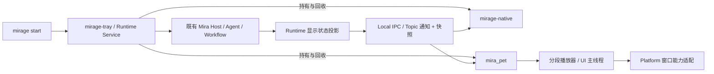

# mira_pet：独立进程、状态投影与动画播放设计

> 状态：Proposed
> 日期：2026-10-12
> 负责人：Mirage 维护者
> 所属计划：[M8](../plans/m8-mira-pet.md)
> 决策：[DEC-084](../decisions/DEC-084-mira-pet-process-and-animation.md)
> 状态投影、IPC 与纯播放时钟已有首批实现；独立可执行程序、解码渲染及平台运行保证仍待实施。

## 1. 目标与架构

主窗口被遮挡、最小化或关闭时，用户仍能通过 Mira 桌宠动作看见当前工作阶段与结果。
桌宠保持透明、无边框、置顶且不抢焦点；窗口只显示角色，不绘制底部状态条。
详细任务摘要、用时与活动数量仍由主窗口提供，不编造完成百分比。

桌宠不承载 Agent、桌面工具或第二份 Mira。服务端统一投影多个执行来源，客户端
只做显示 reducer 与播放状态推进。保持 `apps -> runtime -> desktop -> platform`
方向；平台/第三方类型不进入 Mirage 公共契约。已有 Overlay 保持目标高亮与确认职责。

## 2. 依赖能力核对与复用

| 能力 | 已核对入口 | M8 承载方式 |
| --- | --- | --- |
| Agent/Task/Workflow 与终态 | pinned Mira `docs/api/model-agent-loop.md`、`include/mira/conversation_loop.hpp`、`include/mira/model_gateway.hpp`；既有 MiraHost/ModelLayer | 复用既有运行和结算；Adapter 仅投影有界显示阶段 |
| 工具过程 | `DialogProcessSink`、会话 `parts`/`process_sequence`，DEC-049 | running 工具是阶段线索；实际子动作由执行缝确认，pending 不代表已执行 |
| 通知及重同步 | `runtime/service/src/event_hub.hpp`、IPC v1，DEC-012 | 复用 Topic 和连接级溢出；增加最小只读显示快照 |
| 子进程 owner | `desktop::FrontendProcess`、DEC-045 | 复用平台创建/回收纪律；扩展角色和单实例身份，不能复用“打开即激活”语义来取焦桌宠 |
| UI/窗口/图片 | EUI `include/eui/dsl_app.h`、`include/eui/window.h`、`docs/图片.md`、`docs/动态纹理.md` | 复用透明/置顶请求、本地图片和主线程渲染；可控多帧 WebP 播放尚未证实 |
| 并发与通信 | kairo integration skill 的 scenario router → communication card，公开 `kairo/comm.hpp`、`comm/topic.hpp`、`comm/mailbox.hpp` | Topic 多订阅，LatestMailbox 最新完整显示状态，MpscChannel 有界命令；任务/worker/timer 受唯一 owner 管理 |
| 视觉变换/检测 | Mirador `docs/api/README.md`、公开 `mirador/image/` | 需要缩放、接缝检测时经既有 Adapter 复用；动画片段语义与窗口策略属于 Mirage 产品 |
| JSON | Mira `mira/json.hpp` | manifest/IPC 使用既有编解码与严格预算校验 |

现有会话过程只保证工具 handler 开始后标 running，思考内容在规范响应到达后出现；
不能从历史 thinking 段推断模型此刻仍在推理。M8-01 需为模型调用开始/结束、观察与
输入子动作建立有界显示缝，先核对 pinned 事件和现有 Adapter，避免读取依赖内部状态。
若确认公开能力存在缺口，按台账流程登记；本次未认定依赖缺口，未修改 pinned 源码。

## 3. 显示状态与真实来源

显示状态与 Task/MiraHost 状态分离，不向既有运行状态枚举塞入动画名称。

| 显示状态 | 中文 | 进入依据 | 素材与持续行为 |
| --- | --- | --- | --- |
| `starting` | 启动中 | 产品 owner 正在初始化/绑定，尚未 ready | v5 `mira_enter.webp` 确认版 once；未 ready 时静态持有末帧 |
| `idle` | 待机 | owner Running，活动集合为空且无待处理确认 | `mira_rest.webp` 的独立 loop |
| `thinking` | 思考中 | 实际模型请求/规划工作开始且未结算 | `mira_think.webp` 的独立 loop；不暴露思考正文 |
| `looking` | 观察中 | 截图/语义观察/OCR/动作核验正在执行 | v3 `mira_look.webp` 已确认使用，独立 loop 已验收 |
| `mouse` | 鼠标操作 | 输入租约准入后实际指针动作开始，至释放/清理完成 | `mira_mouse.webp` 的独立 loop |
| `typing` | 键盘输入 | 实际 text/key 输入开始，至释放/清理完成 | v3 `mira_typing.webp` 已确认使用，独立 loop 已验收 |
| `task_success` | 任务成功 | 所选任务/轮次的宿主最终核验与结算成功 | `mira_done.webp` 全片单次播放，随后保持末帧 |
| `task_failure` | 任务失败 | 所选任务/轮次已不可恢复地失败或宿主 Failed | `mira_fail.webp` 全片单次播放后回到待机；同次结果不重播，工具重试不当作任务失败 |
| `exiting` | 正在退出 | 用户确认退出或 owner 正在正常收敛 | v5 `mira_exit.webp` 确认版 once；有界打断，不阻塞取消与 shutdown |
| `waiting` / `paused` / `takeover` | 等待确认 / 已暂停 / 人工接管 | 既有许可、暂停或接管事实 | 共用待机姿态，停止自主动作动画；详细原因在主窗口 |
| `cancelled` | 已取消 | 任务已取消，不等同成功或失败 | 共用待机姿态，安全状态立即切换 |
| `disconnected` / `unknown` | 连接中断 / 执行中 | 连接或快照失效 / 无可靠细阶段 | 静态姿态，禁止保留鼠标/键入等陈旧动画；详细原因在主窗口 |

状态转换规则：

1. 同一任务终态幂等；旧 epoch/revision/动作结果不能复活终态。服务端负责运行事实，
   客户端拒绝过期显示快照；新任务使用新身份，不复用旧任务播放代数。
2. Host Failed/Stopping、人工接管、取消、权限等待和断连优先于普通动作动画。
   清理中的自有按键/按钮仍由原输入生命周期回收，切动画不代表输入已释放。
3. 工具名通过已注册内部工具与操作种类映射，兼容 Provider wire alias；不能用字符串
   包含“mouse/typing”或模型正文识别动作。含观察、输入、核验的组合工具按当前子阶段
   切换，clipboard/file/process 等不冒充键入。
4. 多任务由服务端统一选择：全局安全状态优先，其次当前桌面输入租约持有者；其余维持
   当前仍活动的显示对象，失效后按服务端活动顺序确定选择。IPC 附活动数量与所选稳定
   ID，详细归属在主窗口说明。
5. 暂定成功状态保持 5 秒，再按当前活动集合回落；失败的 Runtime 状态在无新活动时
   保留至新任务开始。成功动画只播一次并静态持有末帧；失败动画只播一次后回到待机。
   播放器保留已消费失败的 owner/source 身份，通知刷新及隐藏恢复不重播同次失败。
   普通状态切换在当前已启动动画完成首轮后采用届时仍有效的最新状态，不排队补播已
   结束的短动作。接管、取消、断连、退出及 owner epoch 切换立即打断视觉播放，
   不为动画完整性延迟业务安全控制。

## 4. IPC 与跨上下文一致性

首批代码已加入 `hello.pet_status`、只读 `pet.status` 完整快照和按需订阅的
`pet.updated`。当前字段与限制见 [IPC 契约](mirage-ipc-protocol-v1.md)；
会话工具进入 running 时已按注册名投影 looking/mouse/typing，模型请求期间投影 thinking；
这仍是工具调用边界，输入工具的授权、目标重验与实际派发可能随后拒绝，尚需在真实
Provider 派发点补精确子阶段证据，不将其写成已完成的九态链路。

建议字段：`schema_version`、`owner_epoch`、`revision`、`host_state`、`display_state`、
`session_id`、可选 `task_id` / `turn_id` / `run_id` / `action_id`、`active_count`、
有界 `summary`、`reason_code`、阶段已持续的 `elapsed_ms` 与可选 determinate progress。
不同进程不直接比较单调时钟时间点；elapsed 由服务计算，客户端只估算显示用时。
快照暂定最多 4 KiB、摘要 256 字节，不携带输入文本、凭据、截图或私有思考。

客户端先订阅，再读快照，并按同一 owner epoch 的 revision 合并；IPC 连接 seq 仅用于
发现通知缺口。溢出/缺口走完整快照恢复，不回放动作动画日志。运行中没有新事件不等于
失联：长推理仍可保持同一阶段，用有界快照健康探测核对 owner；暂定每 2 秒一次、
最多一项在途，连续健康失败或传输断开转 disconnected，预算和期限在 M8-01 测试冻结。
订阅通知与快照竞态、重连至新 owner、迟到资源加载均检查代数。

桌宠端后台最新状态使用 LatestMailbox；渲染线程只消费最新完整快照。FIFO 用户命令
用有界 MpscChannel（暂定 16 项），满时明确拒绝。复用服务 Topic 通知路径与统计，
不自建共享可变状态 + mutex/条件变量的调度或消息系统。

## 5. 素材库存与裁切契约

当前本机源目录：`~/下载/mira_pet_v5_桌宠素材包/`。仅作为素材交接来源；安装产物通过
相对受控资源目录查找，不能依赖该绝对路径。库存证据见
[v5 容器核对](../compatibility/data/mira-pet-assets-v5-20261012.json)。
[v3 容器核对](../compatibility/data/mira-pet-assets-v3-20261012.json) 与
[v2 容器核对](../compatibility/data/mira-pet-assets-20261012.json) 为历史记录，不覆盖。

| 源文件 | 帧数 | ANMF 单帧时长 | 实际全片时长 | 交付角色 |
| --- | --- | --- | --- | --- |
| `mira_rest.webp` | 50 | 167 ms | 8350 ms | 待机，循环区间待逐帧确认 |
| `mira_think.webp` | 55 | 125 ms | 6875 ms | 思考，循环区间待逐帧确认 |
| `mira_look.webp` | 96 | 100 ms | 9600 ms | v3 looking 已确认使用，循环区间待确认 |
| `mira_mouse.webp` | 59 | 91 ms | 5369 ms | 鼠标，循环区间待逐帧确认 |
| `mira_typing.webp` | 74 | 71 ms | 5254 ms | v3 typing 已确认使用，循环区间待确认 |
| `mira_done.webp` | 56 | 83 ms | 4648 ms | 成功，全片 4648 ms 单次播放 |
| `mira_fail.webp` | 55 | 125 ms | 6875 ms | 失败，全片 6875 ms 单次播放 |
| `mira_enter.webp` | 54 | 83 ms | 4482 ms | v5 确认启动动作，once |
| `mira_exit.webp` | 52 | 100 ms | 5200 ms | v5 确认退出动作，once |

九个主文件均为 512×512 动画 WebP，容器 loop count=0（无限循环）。包内状态 JSON
却将 enter/exit 声明为 once，播放器须显式覆盖容器设置，不能把登场/离开无限重复。
v5 的 enter/exit 已替换，其余七个文件与 v3 摘要一致。此证据只证明
容器结构/时长和文件差异，未验证逐帧 alpha、动作接缝或原始绿幕质量。v3 包中仍带
名为 `mira_pet_preview_v2.png` 的预览，不用它冻结更新动作的裁切端点。
README/JSON 的理想 fps 与容器实际整数毫秒有差异，播放器以逐帧 duration 为准。
`lite/`、poster 和 `source_green/` 保留为待评估来源，未计为正式运行资源。

### 5.1 每状态单独记录 manifest

建议 manifest 包含 schema/version、asset revision、源 SHA-256、角色锚点/画布、
逐帧时长和资源映射，以及 `playback`（`loop` / `once`）、`intro`、`loop`、`outro`。
帧号采用从 0 开始的半开区间 `[begin, end)`；循环状态的 loop 至少一帧且不得超界，
once 使用独立播放区间、不要求循环段，缺省不解释为全片无限循环。intro/outro
可为空，播放区间与原始源的精确映射及变换工具版本必须可追溯。looking 使用稳定状态键，
不强制未来文件继续叫 `mira_look.webp`；typing 同理。

M8-02 用逐帧查看和连续播放为七个运行动作选择“动作已就位、姿态持续”的区间。必要时
额外导出该区间作为独立循环资源，保留全片源与区间记录。已加在全片末尾的首帧交叉
溶解不能自动用于新 loop；接缝不连续时重新选端点，或明确记录获准的拼接处理。
不能统一截取相同比例、中间几秒或整片；循环区间和接缝逐个验收至少 20 圈。
v5 九态源动作已确认，仍需裁切、缓存与切换测试。enter/exit 按 once
验证播放区间与有界打断；未来素材变更须生成新 revision 并重新验收，不人为循环淡入/淡出。

已按逐帧接触表选出 [v5 候选区间](../compatibility/data/mira-pet-loop-candidates-v5-20261012.json)：
rest `[8,44)`、think `[22,33)`、look `[22,89)`、mouse `[22,33)`、typing `[27,51)`、
done `[46,54)`、fail `[12,25)` 是历史接缝评审区间。维护者于 2026-10-13 确认
七态各 20 圈接缝无视觉问题，证据见
[视觉验收](../compatibility/data/mira-pet-loop-visual-acceptance-20261013.json)。
同日按维护者要求，将 done/fail 的实际播放改为全片 once；enter/exit 同为 once。
当前运行策略见 [播放 manifest](../compatibility/data/mira-pet-playback-v5-20261013.json)，
历史候选不覆盖。接缝验收不代替真实 compositor/目标窗口验收。
`runtime/pet` 的纯时钟播放器已按这些区间实现 intro 一次、loop 重复、once 停留末帧；
可选 Linux 预览进程已接 WebP 帧解码、EUI ImageStream 和 kairo timer。
20 圈人工接缝验收已由维护者确认；实际窗口门禁仍独立开放。

### 5.2 运行时播放状态机

循环播放器推进为 `Loading -> Intro -> Loop -> Outro/Interrupted`；once 为
`Loading -> Once -> Finished/Interrupted`，另有静态占位和停止状态。
用注入的单调时钟计算帧位置，卡顿时跳过过期帧，禁止积压补播。资源就绪才开始
首轮计时；循环动画至少完成 intro 加一个 loop（至 `loop_end`），once 至全片结束。
首轮期间只观察最新服务状态，不积压动作队列；到首轮边界时只播放届时仍有效的
最新状态，已经结束的短动作不补播。加载期间未开始的动画可被最新状态替代。
重复收到同一状态不重启 intro；同状态新任务
可重新进入。安全状态、宿主断连、owner 切换与退出立即打断，业务控制不等待动画。

当前预览通过桌宠进程既有 Executor 的 `submit_cancellable()` 读取并解码 WebP，
UI 不执行磁盘读取或解码。加载器只保留一个 future 和一个最新目标；切换先释放 UI
旧片、请求取消旧任务，消费其 future 并释放结果后才接纳最新目标。读取每 64 KiB、
解码每帧检查 StopToken，运行时按编译入程序的 manifest SHA-256 验证源文件；
缺失、摘要错误、非法路径/区间、尺寸预算、异常与提交拒绝均给出诊断。摘要计算复用
pinned Mira 的 `digest_bytes()`，不新增哈希实现。

每片最多 96 帧、96 MiB 解码结果和 8 MiB 源文件。EUI-20261013-001 在升级
至包含 PR #97 的 dev pin 后已修复；当前提交不可变 RGBA 帧到容量为 1 的公开
ImageStream，源帧 1 MiB、fallback 转码/纹理及字体另计。状态变化时优先提交已缓存的
待机中性帧，避免异步加载间隙出现透明空帧；中性帧尚不可用且进入安全状态时清图，
隐藏的 clear 延至恢复后首个 UI 更新；提交失败写入可观察诊断。旧的公开
GPU import Adapter 已移除，历史对比见台账与升级审计。解码器内部缓冲、驱动纹理
和字体另行计入实测进程/GPU 峰值。每次请求的暂定 2 秒期限包含
等待旧任务、排队和解码；超时只请求协作停止，不能强制打断 OS 文件调用。旧 generation
永不更新 UI。加载期间保持中性姿态，成功后从首帧开始计时，卡顿不补播积压帧；
失败记录诊断。安全状态清除陈旧动作帧。

资源工件布局沿用原生产品的可执行文件相对目录：`bin/mira_pet`、
`bin/assets/pet/` 下九份原始 v5 WebP、`bin/assets/NotoSansSC-Regular.otf` 与字体
许可声明；build 预览对应 `apps/pet/` 下同一相对结构。分段由 manifest 驱动，不再
要求离线 PNG。源摘要表从版本控制的 manifest 生成到构建树，运行程序不回读下载
目录。实际安装载荷、素材使用许可和安装/升级/卸载仍由 M8-08 验收。

UI 主线程持有播放器、RGBA 引用与 GPU 资源，kairo timer 负责唤醒。Linux X11
最小化回调链保留 EUI 原回调，停止动画 timer、取消当前加载并清除 UI 帧；IPC 健康
探测继续运行，恢复后重新加载最新状态并从首帧推进。其他隐藏形式由 M8-06 的
避让接口接入后单独验证。GPU 占用与真实 compositor 效果仍保留门禁。

启动/退出当前使用 v5 enter/exit 确认动作。启动 once 播完
仍未 ready 时保留末帧姿态；ready 到达后转入待机或活动动画，播完不
自动销毁仍需展示运行状态的桌宠。退出 once 受 owner 关闭预算限制；当前 Linux
预览由父进程发出有界退出请求，最多等待 6 秒播放 5200 ms 素材，超时仍强制回收。
最小化时 EUI 主循环不执行帧回调；此时健康 timer 通过独立 X11 连接发送关闭事件，
跳过动画并走 UI 正常 teardown。隐藏状态的宿主失联也走该路径；显示状态为断连
后仍保留 5 秒提示，隐藏路径按 2 秒健康探测采样判定，响应正常的 X11 服务下约
5～9 秒后退出。OS 事件投递失败只报告一次，不无限重试；外部 owner 仍可按期限回收。
缺失/损坏时以静态姿态降级，诊断写入进程日志；加载结果、摘要错误及降级可观察，
不影响任务执行。

## 6. 窗口、输入与感知边界

- 默认置顶请求、透明 framebuffer、无边框、240 逻辑像素角色画布、边缘停靠，不定时
  抢焦或反复 raise。X11 角色拖动结束时经既有 LocalStateStore 原子保存位置；重启时
  按当前显示器工作区约束恢复，旧屏幕移除时回退到主屏工作区。
- 透明区域默认输入穿透；角色拖动区与打开主窗口/关闭提示等交互区单独定义。实现前
  验证非激活窗口、click-through 和多屏坐标语义，所有 OS 调用封装于 Platform 边界。
- 当前 X11 实现依据已提交 RGBA 帧生成 ShapeInput 区域：透明背景穿透，角色实体
  可按住拖动；拖动范围限制在工作区。窗口与角色布局按实际 framebuffer 尺寸计算，
  避免 HiDPI 下裁切。窗口设置 EWMH `SKIP_TASKBAR`/`SKIP_PAGER`，不作为独立 Dock
  应用显示。Windows 和原生 Wayland 另行验收。
- 提供手动移开和自动避让。Runtime 的目标/输入租约与桌宠占位冲突时，先请求移至不
  重叠安全区域并取得新几何确认，再重新观察/解析；无安全区域时有界隐藏，动作释放后
  恢复。移动/隐藏失败拒绝冲突动作，不绕过已有焦点或遮挡守卫。文字说明短暂避让。
- 截图中角色可能形成假目标、OCR 文本或像素变化。仅从 owner 核验的桌宠身份识别产品
  窗口，按平台可用能力排除或在采集前避让/隐藏并刷新证据；不抹除实际被挡的底层像素，
  不按名称、宽泛 PID 规则或白名单放宽第三方遮挡判定。与现有 Overlay 同场景回归。
- X11 首验透明合成器、置顶、不同应用切换、非激活、穿透和全屏。XWayland 与原生
  Wayland 分开记录；原生 compositor 无所需能力时记录限制和补跑条件。Windows 单独
  验证 topmost/每像素 alpha/输入穿透、显示缩放、全屏及多屏，不用交叉编译代替运行。

“始终顶层”为正常桌面场景验收目标；系统锁屏、安全桌面及 compositor 不授予的层级
不靠抢焦、提权或忙循环强行实现。能力不满足时桌宠诊断可见，平台工作项保持未完成。

## 7. 进程生命周期与 Executor

托盘产品入口完成 owner/IPC 准备后启动一个受管桌宠。为展示 Runtime 启动阶段，
M8-05 核对现有 readiness 顺序，必要时增加受管 bootstrap 状态；桌宠在能力与子进程
身份核验前不创建正式窗口，不能从“托盘已完全 ready”之后才凭空补播启动状态。
桌宠自身初始化与 Mira 启动分别标识，重复开启桌宠不伪造 Mira 重启。

| 工作 | 承载与 owner | 取消/完成证据 |
| --- | --- | --- |
| 服务状态投影/子进程请求 | Runtime owner 的既有串行执行域 | 有界提交结果、序号与平台诊断 |
| 桌宠 IPC 收发/健康探测 | 桌宠进程唯一 Executor 的 blocking worker/timer | wake/关闭连接解除等待，消费 worker/task 结果 |
| 资源读取/解码 | `submit_auto()`；长加载需协作取消 | 保留/消费 future，新 asset/状态 generation 拒绝迟到结果 |
| 动画唤醒/短期结果保持 | owner 的 timer handle + UI 主循环有界推进 | 持有 timer handle，隐藏/关闭取消；不使用私有定时器 |
| 平台/窗口 SDK 回调 | 有界校验与投递，UI/Platform 线程亲和边界 | 队列拒绝、背压和诊断可见 |

正常退出先停止新自主动作与生产者、请求取消/接管、释放输入、回收运行任务；桌宠
显示 exiting 并最多等待暂定 2 秒收尾/ACK，随后停止其 IPC/资源任务，在非 worker
owner 线程 shutdown，托盘回收子进程并完成原 Runtime teardown。超时、系统信号或
owner 故障跳过视觉收尾，安全关闭优先。进程断连后停止动作动画、短暂明确提示并
有界退出；手动重新启用走托盘 owner，不由桌宠反向启动服务。

子进程崩溃不终止 Mira，记录产品呈现失败；首版不自动无限重启，支持用户明确恢复。
一个桌宠对应一个在线 owner，重复入口复用而不重复创建。关闭桌宠与退出 Mirage
是不同操作，设置持久化需与既有偏好及严格读取器版本兼容。

## 8. 交付与验证约束

源素材摘要、版本、使用许可、裁切区间、转换工具和工件包摘要纳入供给记录，安装包
只带已验证运行资源及必要字体/声明。素材工件缺失的离线 configure/package 必须
明确报错，不能临时从用户下载目录或网络拾取。

逐阶段验收与环境限制在 [M8](../plans/m8-mira-pet.md) 留存。性能只先记录 CPU/GPU、
内存、切换延迟和隐藏唤醒基线；未实测不宣称低功耗、实时状态或跨平台一致性。

## 2026-10-13 增量：独立控制与 EUI 转码修复消费

M8-05 的托盘菜单增加条件式桌宠入口：载体缺席时不展示；starting/stopping 时禁用，
running 可关闭，stopped 可启动，failed 可显式恢复。SDK 回调仅投递既有 MpscChannel，
Runtime 串行控制状态，菜单通过 LatestMailbox 消费完整状态。具体 PID readiness、
10 秒 bootstrap 期限和异步关闭语义见 [IPC 契约](mirage-ipc-protocol-v1.md)。
托盘启停偏好与大小设置仍属于 M8-08；X11 拖动位置由 M8-04 保存和恢复。

维护者授权后，将 EUI 从 a7e625f 升级至上游 dev 89c2d0f（v0.6.1 preparation），
消费已合入 PR #97 的逐像素推进修复。角色恢复使用容量为 1 的公开 ImageStream，
提交 immutable 512×512 RGBA 帧，清图也提交透明帧。删除临时 OpenGL FrameTexture
及 native GL 上传；EUI 自己管理 fallback 和 GPU 资源，Mirage 不再需要绕过转码。
原 Adapter 和故障证据仍保留在历史验证记录；升级审计见
[EUI RGBA 升级记录](../supply-chain/eui-rgba-upgrade-20261013.md)。

## 2026-10-13 增量：接缝验收与结果单次播放

维护者明确确认七份候选循环各 20 圈无接缝问题，并要求实际成功/失败只播一次。
当前五个运行状态保留已经验收的循环区间；成功 `[0,56)` / 4648 ms，失败
`[0,55)` / 6875 ms，和 enter/exit 一样按 once 推进。单次完成后静态持有末帧，
停止动画唤醒；主窗口状态文字继续来自真实投影。成功投影仍按原 5 秒规则回到待机，失败
提示仍保留到新活动/安全状态；播放器完成不是新任务完成事件，也不会触发窗口退出。
状态相同且 source/owner 不变时不重播，下一任务身份可重新播放；接管/取消可以立即
打断，不为播放完整性延迟业务控制。本增量没有改变 IPC 或 Mira 的任务结算。

## 2026-10-13 增量：角色独立呈现与首轮播放

维护者要求桌宠只显示角色、不占用左侧 Dock、重启恢复上次拖动位置，并避免动画
快速切换导致动作漏看。上述窗口与播放器策略已写入第 3、5、6 节；普通动画在资源
就绪后至少完成首轮，首轮期间的中间状态不入队，边界处只采用最新有效状态。
这一视觉延迟不改变 Runtime 的任务事实或输入控制；安全状态保持立即打断。
维护者随后要求失败动画结束后进入待机；已消费失败身份独立于可见播放状态保存，
同次失败不重播，下一任务失败可以再次播放。
